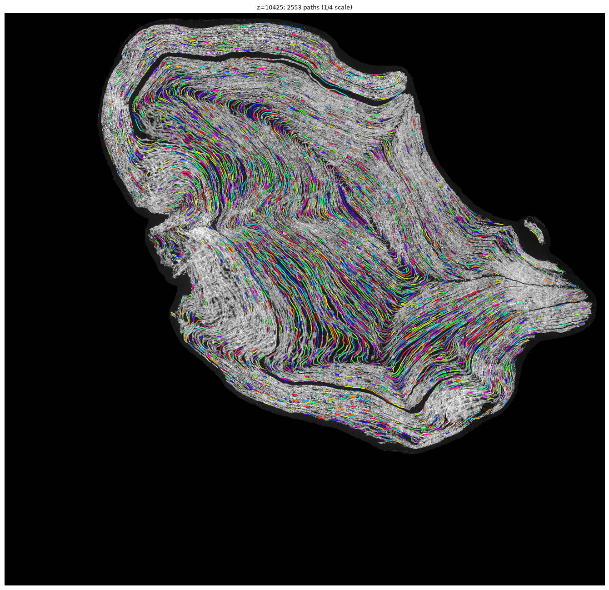
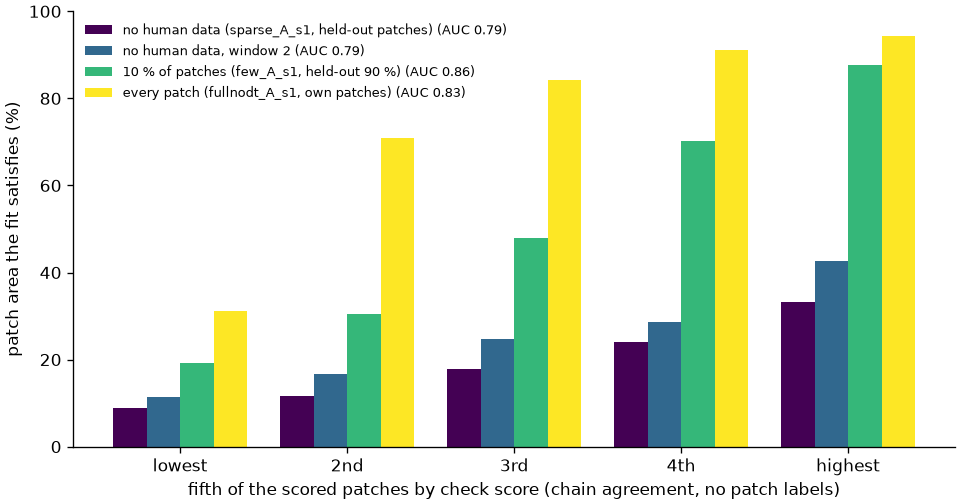
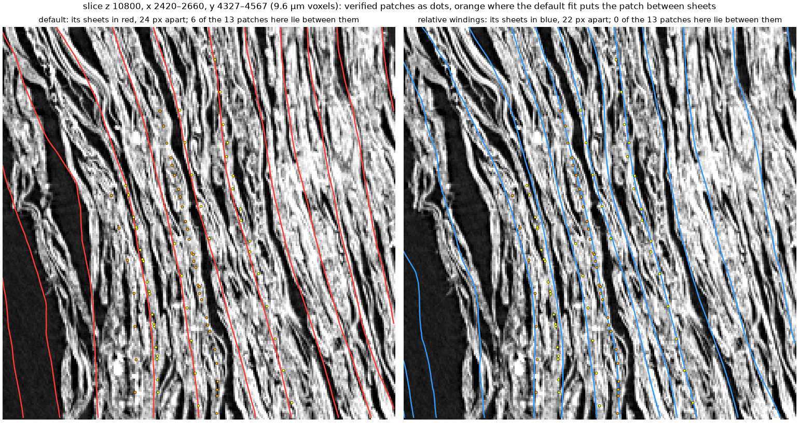
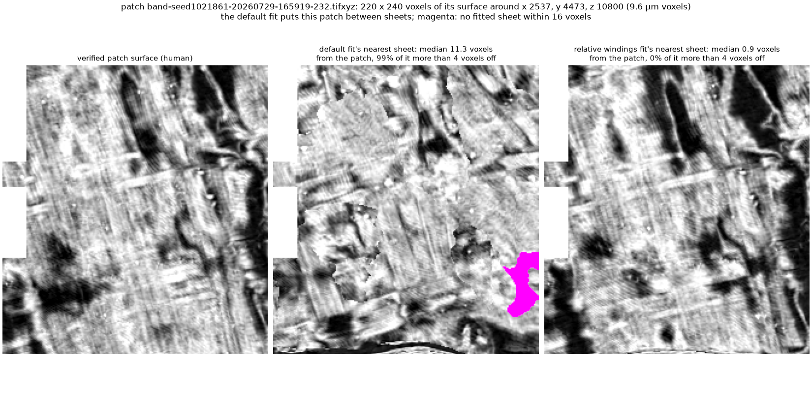
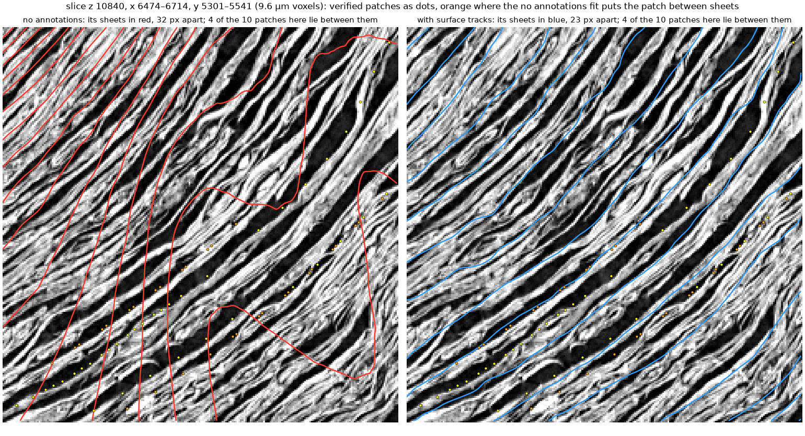

# windcon — automatic winding constraints for the Vesuvius Challenge spiral fit

Automatic **"drawn paths"**: long, precision-first same-winding point strips traced in single XY
slices of the CT volume, linked through z into chains, and **relative windings** between
neighbouring paths (pairs of points on adjacent sheets, one winding apart). Both are written as
point-collection documents that `villa/spiral-fitting/fit_spiral.py` already consumes.

## Findings in brief

Measured on PHerc. Paris 4 with the published `fit_spiral.py`, scored on human annotations the fits
never saw (details and numbers in the sections below). Round 7 corrects two things about points
2–5: their fits ran without villa's surface tracks, the fitter's default, and 92 % of the verified
patches they call human were grown automatically. Point 6 is the result with the tracks on.

1. **The tracer is precise.** 97.6 % of traced length lies on the human arc it claims (held-out
   slices); paths cover 39 % of the arcs' length. Paths link across slices into chains with 1.0 %
   wrong links where verified patches can check them.
2. **As fit input, the chains help only without human annotations and without the surface tracks
   (point 6).** Chains traced every 5th slice raise held-out verified-patch area from 19.4 % to
   28.6 % and from 25.6 % to 34.5 % in a second window. With a tenth or all of the human patches
   they add nothing or trade one held-out measure against another; relative windings derived from
   the same paths do help there (point 5).
3. **As a check of a finished fit, they find its errors without human input.** Where a fit
   disagrees with the chains on a verified patch, the fit has likely failed that patch (AUC
   0.79–0.86 for fits with no, some or all human data, in both windows).
4. **More annotation does not fix those errors.** Patches added where the fit fails make it worse:
   the fit cannot satisfy them together with their neighbours, and even fits trained on every
   patch fail them. The failing patches are consistent sheets that the fit places half a winding
   from their neighbours, where the scan shows sheets packed more tightly than around them (13.2
   against 15.9 px per winding). A finer deformation lattice, a softer regulariser, no winding
   inference or no human point collections do not change that. Starting `fit_spiral.py`'s patch
   snap at step 10,000 instead of 25,000 lets a sparsely annotated fit satisfy both sets, but costs
   held-out arcs and fibres between the patches; with every patch the gap stays (65.5–67.8 % of
   the failing patches satisfied against 88.2–88.3 % of random ones).
5. **Automatic relative windings reduce that conflict.** Pairs of traced points on adjacent sheets,
   one winding apart, give the fit the scan's local winding spacing. With every patch (two seeds)
   the fit satisfies 76–83 % of the failing patches instead of 60–62 %, 87 % of all its patches
   instead of 77–78 %, and 34 % of the held-out eval fibres instead of 27–30 %; held-out arcs end
   at the low end of the default range. In the second window (two seeds) every measure moves the
   same way but less: training patches 77.0–80.1 → 80.4–81.8 %, failing area 21.1 → 17.4 %. A
   double sampling share for the pairs (one seed per window) adds to the gains in window 2 and
   removes the arcs cost in window 1. With a tenth of the patches (three seeds) they keep the
   failing patches from hurting the fit (held-out area 60.3–60.6 % with them against 53.8 %
   without) and raise held-out area by 1.7 points on their own, at a cost of 2–3 points of arcs.
   Round 6 shows the effect in one slice and on one patch's surface.
6. **With villa's surface tracks on, most of the fit comes from them (round 7, window 1, one seed
   per fit).** The tracks are an automatic input that the fitter leaves off by default. With them
   and no annotation the fit keeps 60 % of the human-curated patch area (16 % without them, 20 %
   with the chains), 71 % of the held-out arcs (27 %, 36 %) and 39 % of the eval fibres (16 %,
   17 %). That is more than a tenth of the verified patches with the human point collections
   gives, and close to the all-patches fit on arcs. On top of the tracks the chains hurt (curated
   area 60 → 43 %): as a fit input the tracks replace them. The relative windings help in one
   place, where automatic patches are fitted. Band-seed patches alone lower the tracks-only fit
   (curated area 51 %, arcs 61 %); with the pairs it comes back (62 %, 71 %) and the patches
   themselves go from 77 % to 87 % satisfied. On the tracks alone the pairs do not help, and
   without the winding-inference rays, which no other scroll has, they cost 6 points of curated
   area. The chains keep their second use: they flag the patches a tracks-based fit fails (AUC
   0.84), and the share of traced paths a fit keeps on one winding ranks fits as the held-out
   truth does (Spearman +0.9 over 35 fits that trained on no path).



*Slice z 10425 at quarter scale, every traced path in its own colour. Per-arc comparisons on the
held-out slices: [`results/panels_test.png`](results/panels_test.png) (human arc yellow, traced
path green, vertices after a departure red).*

## Why this problem

[Open Problems 2026](https://scrollprize.org/2026_open_problems) lists six ways to help. The
[winding-constraints deep dive](https://scrollprize.org/open_problems/winding_annotations) narrows
the team's priority: *"the fastest way to unroll scrolls at scale is to develop methods for creating
winding constraints that are precise and fast enough to use widely"*, with a generator that is
accurate (or measures its confidence), fast, easy to verify, and pluggable into the spiral fit.

- Automatic **relative**-winding constraints already exist (`winding_inference/`: an ML phase model,
  1.1 M rays, 22.7 M crossings in the published `spiral-input` dataset). **Drawn paths** are listed
  under *"Things we have not tried"* and *"likely ... doable with classical computer vision"*.
- Constraints here: Apple M2, 8 GB RAM, no NVIDIA GPU, ~3.3 MiB/s to the open-data bucket. That
  favoured classical CV on streamed crops. The spiral fits below ran later on a separate Ubuntu
  machine with an RTX 4070 SUPER (12 GB).
- Ground truth exists to measure precision: 50 human same-winding arcs drawn inside single slices.

## Data

| What | Where |
| --- | --- |
| CT | PHerc. Paris 4, scan `20260411134726` (2.4 µm, BM18), OME-Zarr level **2** (9.6 µm), `s3://vesuvius-challenge-open-data/PHercParis4/volumes/20260411134726-2.400um-0.2m-78keV-masked.zarr/2` |
| Ground truth | `same_windings.json` from the [`spiral-input` dataset](https://dl.ash2txt.org/datasets/spiral_datasets/PHercParis4/) |

Level 2 is the coordinate frame of the `spiral-input` annotations: points are `p = [x, y, z]` in
9.6 µm voxels (checked by overlaying `relative_windings.json` collections on CT slices; the dataset
README's `(z, y, x)` note does not apply to the point-collection files). Chunks are 128³ raw `uint8`
(2 MiB, uncompressed); `windcon.zarr_io` fetches only the chunks a crop touches and caches them
under `data/cache/`. It reads the bucket's keys through the CloudFront mirror
`data.aws.ash2txt.org/samples`, which serves the same bytes: from Indonesia the mirror gave a
steady 23 MiB/s where the bucket gave 2–20 MiB/s with stalled and reset connections.

## Method (`src/windcon/tracer.py`)

In an XY slice a winding is a bright, textured band between dark gaps. From a seed on a band the
tracer steps 2 px along the band tangent (Hessian eigenvector, σ = 3) and re-centres on the band
using a *thick* normal profile (averaged ±3 px along the tangent to wash out fibre lumens). The band
is delimited by its first valley on each side and centred between its half-level edges. A step is
accepted only if the band is bright, has a real gap on **both** sides, is no wider than one sheet,
moves < 2 px sideways, turns < 15°, and has **no neighbouring band within 8 px** — the signature of
a fork, a merge or a delaminating sheet, the dominant failure mode seen on real data.

- Fork/merge signatures stop the trace immediately; other failures (faint gap, dark spot, crossing
  fibre) may be bridged by coasting ≤ 4 steps, kept only if the band is re-acquired where predicted
  and holds for 3 more steps; every stop trims the last 3 steps.
- Region mode seeds on a 6 px grid, best gap contrast first, skipping seeds on territory already
  claimed by an earlier path; a trace that runs onto another path for 3 steps stops (`joined`).
- Input slice = mean of z−2..z+2 (sheets run roughly along the scroll axis).

## Evaluation (`src/windcon/evaluate.py`)

Production-like **auto mode**: trace every band in a crop around each human arc without looking at
the arc; a path *claims* the arc if 5 consecutive vertices lie within 3 px of it. Walking out from
there, a claiming path is **correct** while within τ = 6 px (median sheet pitch is 21 px) and has
**departed** once it stays farther than τ for 3 vertices while still inside the arc's extent; all
later in-extent length is **wrong**. Path beyond either end of the arc is unscored.

- **precision** = correct / (correct + wrong) path length; **coverage** = union of arc length spanned
  by correct vertices / total arc length; **departures/claim** = share of claiming paths that left.
- Development slices: z ∈ {10604, 12418} (22 arcs, 11.8 k px). Held out: z ∈ {7888, 10343, 13000,
  13500, 14068} (28 arcs, 22.8 k px). Disclosure: after the first test run I inspected test-set
  departures and tried one change (16 px end trim); it did not help on test and was reverted, so
  the numbers below are the configuration chosen on dev, but the test set has been looked at.

### Results

| Fork guard `--min-neighbor-dist` | dev precision | dev coverage | test precision | test coverage | test departures/claim |
| --- | --- | --- | --- | --- | --- |
| 10 px | 1.000 | 0.104 | 0.983 | 0.262 | 0.059 |
| **8 px (default)** | **1.000** | **0.162** | **0.976** | **0.388** | **0.101** |
| 6 px | 0.993 | 0.247 | 0.946 | 0.524 | 0.147 |
| off | 0.970 | 0.300 | 0.943 | 0.561 | 0.152 |

Test precision by slice at the default: z=10343 0.997 (74 claims), 7888 0.970, 14068 0.918,
13500 0.884, 13000 0.882 (5–17 claims each). Coverage collapses in compressed regions (z=10604:
0.094) because the tracer refuses to continue where neighbouring sheets touch. Correct path vertices
sit a median 1.35 px (p90 3.4 px) from the human lines.

Remaining errors are short departures (6–60 px) at low-angle forks and sharp folds where the branch
the tracer keeps is a clean band; see `results/panels_test.png` (green = claiming path, red = after a
departure, yellow = human arc).

Speed: a 492×698 px crop traces in ~1.8 s on one M2 core (65 paths, 5.3 k px), so a full 6000² px
slice is ~3 min/core. On this connection the bottleneck is bandwidth: one 128-slice chunk row of a
full slice at level 2 is ~4 GiB.

## Does it help the spiral fit? (A/B test, `experiments/spiral_fit/`)

Question: does adding the traced paths make `fit_spiral.py` agree better with human annotations it
never saw? Window z 9900–10900 of PHerc. Paris 4, 30,000 steps per fit, villa commit `5a4388f`,
the published `spiral-input` data this window needs (9,424 patch folders, the window's rows of the
level-4 normals sidecar, winding inference, outer shell).

- **Automatic paths:** 47,227 paths (3.0 M px, 197 k points) traced in 18 whole slices every 50
  slices, none within 25 slices of the held-out arcs (`results/spiral_fit/auto_z10425.png` shows one
  slice). Fed as `drawn_control_points.json`, which the fitter samples as its own group of
  same-winding strips.
- **Families:** *sparse* = no human annotations (umbilicus, outer shell, normals, winding
  inference only); *full* = every human input in the window except the held-out arcs. Round 7
  adds two facts about both: the fitter's surface tracks were off in every fit of rounds 1–6, and
  92 % of the verified patches that *full* trains on were grown automatically.
- **Variants:** A = without paths; B = with paths, fitter defaults; C = B without the strip snap
  (`loss_weight_unattached_pcl_dt = 0`); D = C with 10× unattached strips per step
  (`sample_count_unattached_pcls_per_step = 840`). The full *no-snap* pair applies the D settings
  to both arms.
- **Scoring:** each finished checkpoint is resumed for zero steps with only the scoring inputs
  enabled, so the fitter writes its own satisfaction metrics (`satisfaction_metrics.py`): a point
  passes if it lies within 0.45 of a winding pitch of its collection's winding in spiral space and
  within 6 voxels of that winding's surface in scan space. Never a fit input: 35 human same-winding
  arcs in slices z 10343 and 10604, and 271 human-traced 3D fibres from the dataset's
  `eval_fibers/`. Held out in the sparse family only: the window's 9,174 verified patches and 34
  relative-winding collections.

Sparse family (all held out; %, seed 1 / seed 2):

| metric | A: no paths | B: paths | C: paths, no snap | D: C + 10× strips |
| --- | --- | --- | --- | --- |
| verified patch area | 19.4 / 19.4 | 17.7 / 18.5 | 23.7 / 23.6 | 24.8 / 24.4 |
| arcs, points | 26.7 / 30.3 | 22.1 / 23.3 | 27.6 / 27.8 | 28.6 / 28.3 |
| eval fibres, points | 15.8 / 15.6 | 10.5 / 10.8 | 13.6 / 13.4 | 14.9 / 15.4 |
| relative windings, points | 41.0 / 38.6 | 40.4 / 38.0 | 46.4 / 50.0 | 45.8 / 46.4 |

Full family (%, seed 1 / seed 2; the no-snap pair has one seed):

| metric | A: no paths | B: paths | no-snap A | no-snap D: paths |
| --- | --- | --- | --- | --- |
| held-out arcs, points | 74.2 / 74.6 | 70.1 / 72.8 | 77.7 | 72.9 |
| held-out arcs, whole arcs | 34.3 / 37.1 | 34.3 / 37.1 | 34.3 | 31.4 |
| held-out eval fibres, points | 27.9 / 29.2 | 30.8 / 30.9 | 30.3 | 30.3 |
| relative windings (training input) | 98.2 / 97.0 | 97.6 / 95.8 | 91.0 | 85.5 |
| verified patch area (training input) | 78.4 / 77.7 | 75.9 / 76.6 | 77.3 | 78.1 |

- With the fitter's defaults the paths hurt slightly in both families.
- Without human annotations and without the snap they help: held-out patch area +4–5 points and
  relative windings +5 to +11 points, in both seeds; held-out arcs and fibres do not improve.
- With human annotations they do not help: held-out arcs −2 to −5 points with or without the
  snap; fibres +2–3 points with the defaults and unchanged in the no-snap pair.

Diagnostics:

1. **The snap.** From step 25,000 the fitter snaps every same-winding strip onto its nearest
   winding. In B that loss jumps from 0 to 48.5 at step 25,200 and the final total loss is 80
   against 7 for A. Switching it off (C/D) removes the harm in the sparse family.
2. **Offset** (`offset_check.py`). Traced points sit a median 1.1 voxels outward of nearby verified
   patch surfaces (middle 50 %: −2.7 to +0.5); the held-out human arcs sit at +0.3 (−0.3 to +0.8).
   The tracer centres on the middle of the bright band; the patches and the human arcs agree with
   each other, the traced points sit about 1.4 voxels farther out and are about 3× noisier across
   the sheet.
3. **Short paths** (`analyze_auto.py`). Median ≈ 55 px, 3–4 points each. The human-informed fit
   already agrees with 85 % of path points (ignoring the 6-voxel scan test) before seeing them,
   86 % after. The no-human fit disagrees most with the long paths (77 % of points agree for 40–60
   px paths, 35 % for ≥ 400 px), which is where the new information is.
4. **Sampling share and patch links.** The fitter draws equally from each source file but averages
   its point-collection losses over the sampled points (`sample_shares.py`). In `full_B` the
   automatic paths supply 11.6 % of the strip loss's sampled points and 5.9 % of the
   relative-winding loss's patch pairs, so the human terms keep 88 % and 94 % of their weight: too
   little dilution to explain the drop. But 14,373 paths have two or more points within 2.5 voxels of
   verified patches, which turns them into same-winding links between patches, and the loss on the
   human relative windings rises from 2.5 to 4.5 (mean over steps 15,000–25,000) when the paths are
   added: some of those links contradict the human ones.

### Round 2: paths on the sheet surface, linked through z, with their own budget

The fixes the diagnostics point to, tested the same way (`run_round2.sh` and `run_round3.sh` train
and score, `run_round4.sh` runs the coverage and agreement checks below):

- **Denser slices.** Every 5th slice instead of every 50th: 179 slices (z 9905–10895, still none
  within 25 slices of the held-out arcs), 469,912 paths, 1.86 M points.
- **On the sheet surface** (`chains.py`: `smooth_path`, `shift_inward`). Each path is smoothed
  (Gaussian, σ = 3 vertices ≈ 6 px along the path) and moved 1.9 px along its in-plane normal
  toward the umbilicus (paths running toward the umbilicus stay put). The shift comes from 15 human
  arcs in five slices outside the window (`calibrate_offset.py`: the human points lie a median
  1.88 px inward of the traced paths), so the scoring data stays unused. Against the window's
  verified patches (`offset_check.py`, z 10025, 10425, 10825) the median offset moves from −1.1 to
  +0.2 voxels (human arcs: +0.3). The spread does not shrink: middle 50 % from −1.4 to +1.7
  voxels, against −0.3 to +0.8 for the human arcs.
- **Linked through z** (`chains.py`: `link_slices`, `build_chains`; `build_chains.py`). Paths in
  neighbouring traced slices (5 apart) are linked when each is the other's best partner, with at
  least 8 vertices within 2.5 px of the other path and no third path within 5 px. 181,838 links
  join about 40 % of each slice's paths (median 1.2 px apart) into 288,074 chains: 47 % of the paths
  stay single, 14,555 chains span 5 or more slices (25 % of the paths), the longest 275 voxels of z.
  Each chain is one same-winding collection. Checked against the verified patches (`check_links.py`,
  30,000 random links): in the 8,324 links where the patch under one path also covers its partner,
  the partner lies on another sheet in 1.0 % (7.4 % unclear); 3.0 % of the paths lying mostly on
  one patch leave its sheet somewhere (2.4 % of linked paths, 3.9 % of single ones).
- **Own budget** (`sample_shares.py --emit`, full family). The paths' file gets the same sampling
  weight as each human file and the draw counts grow by one file's share (strips 840 → 1,260,
  relative-winding draws 48 → 64); the strip and relative-winding loss weights grow by the paths'
  expected share of the sampled points and pairs (2.0 → 2.35 and 5.0 → 5.41), so the human terms
  keep exactly the weight they have without paths.
- **No patch links** (`drop_near_patches.py`). A variant drops the path points within 4 voxels
  across or 16 along of a verified patch (788,680 of 1.86 M points), so no path joins two patches.

All round-2 variants use the D settings (no snap, 10× strips). New variants: E = chains (full
family: with own budget); F = the same paths unlinked; H = F without the shift; G = E without the
points on patches; I = E with the fitter's default budget.

Sparse family (all held out; %, one value per seed, mean in bold):

| metric | A: no paths | D: round 1 | E: chains | F: unlinked | H: F unshifted |
| --- | --- | --- | --- | --- | --- |
| verified patch area | 19.4 / 19.4 (**19.4**) | 24.8 / 24.4 (**24.6**) | 29.0 / 28.3 (**28.6**) | 28.0 | 28.0 |
| arcs, points | 26.7 / 30.3 (**28.5**) | 28.6 / 28.3 (**28.4**) | 35.8 / 36.3 (**36.0**) | 31.6 | 35.0 |
| eval fibres, points | 15.8 / 15.6 (**15.7**) | 14.9 / 15.4 (**15.1**) | 16.7 / 16.9 (**16.8**) | 17.3 | 17.2 |
| relative windings, points | 41.0 / 38.6 (**39.8**) | 45.8 / 46.4 (**46.1**) | 45.8 / 50.6 (**48.2**) | 42.2 | 36.8 |

- Without human data the chains now help on every held-out measure, in both seeds: patch area
  +9.2 points over no paths (round 1: +5.2), arcs +7.5 (round 1: none), fibres +1.1, relative
  windings +8.4. The arc gain holds on arcs over patches and away from them alike (+7.2 and +8.2,
  `coverage.json`).
- Density does most of it: the unlinked paths of the 179 slices reach nearly the same patch area
  (28.0) with or without the shift. Linking adds 0.6 points of patch area; its effect on the arcs
  (+4.4 against F, +1.0 against H, one seed each) is within the 3.6-point spread between seeds.
- The shift has no measurable effect (F against H).

Full family (no-snap settings; %, one value per seed, mean in bold). 27 of the 35 held-out arcs and
75 of the 272 eval fibres lie mostly over verified patches (`coverage_split.py`):

| metric | A: no paths | D: round 1 | E: chains, own budget | G: E without patch points | I: E, default budget |
| --- | --- | --- | --- | --- | --- |
| held-out arcs, points | 77.7 / 73.2 / 73.8 (**74.9**) | 72.9 / 73.7 (**73.3**) | 72.7 / 72.7 / 74.8 (**73.4**) | 73.0 / 76.3 (**74.7**) | 76.5 |
| … 27 arcs over patches | 92.9 / 91.2 / 92.3 (**92.2**) | 84.9 / 86.2 (**85.6**) | 87.0 / 85.4 / 87.1 (**86.5**) | 90.7 / 90.0 (**90.4**) | 89.8 |
| … 8 arcs off patches | 47.1 / 36.8 / 36.5 (**40.1**) | 48.8 / 48.5 (**48.7**) | 44.1 / 47.3 / 50.0 (**47.1**) | 37.2 / 48.8 (**43.0**) | 49.8 |
| held-out eval fibres, points | 30.3 / 29.5 / 27.4 (**29.1**) | 30.3 / 31.9 (**31.1**) | 31.6 / 29.7 / 28.4 (**29.9**) | 28.1 / 30.4 (**29.3**) | 31.7 |
| … 75 fibres over patches | 42.7 / 41.0 / 35.1 (**39.6**) | 41.7 / 45.9 (**43.8**) | 43.5 / 38.5 / 36.3 (**39.4**) | 35.6 / 41.3 (**38.5**) | 42.0 |
| … 197 fibres off patches | 25.9 / 25.4 / 24.6 (**25.3**) | 26.2 / 26.9 (**26.5**) | 27.3 / 26.6 / 25.5 (**26.5**) | 25.4 / 26.6 (**26.0**) | 28.0 |
| relative windings (training input) | 91.0 / 92.2 / 91.6 (**91.6**) | 85.5 / 86.8 (**86.1**) | 90.4 / 89.2 / 94.0 (**91.2**) | 92.2 / 91.0 (**91.6**) | 91.0 |
| verified patch area (training input) | 77.3 / 78.4 / 77.8 (**77.8**) | 78.1 / 78.7 (**78.4**) | 78.4 / 78.2 / 78.9 (**78.5**) | 78.4 / 77.8 (**78.1**) | 74.7 |

- Over all held-out arcs no variant beats the fit without paths (74.9 %).
- Over patches the chains cost 5.7 points on the arcs, in all three seeds (92.2 → 86.5); leaving
  out the path points on patches (G) cuts that to 1.8. These arcs carry two thirds of the arc
  points, so the total drops.
- Off patches the chains gain: +7.0 points on the 8 arcs (seed spread about ±5) and +1.2 on the 197
  fibres (+0.9 to +1.4 in each seed pair).
- The own budget does not help measurably: with the fitter's default budget (I, one seed) the chains
  score at least as well on held-out data, though that fit satisfies less of its training patch
  area (74.7 % against 77.3–78.9 % for every other full fit). The human relative windings stay
  satisfied with either budget (E 91.2 %, I 91.0 %, no paths 91.6 %), so their drop with the
  round-1 paths (D, 86.1 %) came from those paths, not from their sampling share.

Do the links hold where no patch can check them? The same points, scored once per single-slice path
and once per chain, against fits that never saw any path (`agree_eval.sh`, `agree_summary.py`;
winding test only, % of points on their collection's winding):

| paths per chain | points | 5 fits with human data: single → chain | 2 fits without: single → chain |
| --- | --- | --- | --- |
| 1 | 785 k | 84.0 → 84.0 | 75.8 → 75.8 |
| 2 | 197 k | 85.0 → 84.7 | 75.6 → 75.0 |
| 3–4 | 226 k | 85.9 → 85.3 | 74.4 → 72.8 |
| 5–9 | 272 k | 86.8 → 85.7 | 71.4 → 68.0 |
| 10–19 | 170 k | 88.3 → 86.7 | 67.2 → 61.6 |
| ≥ 20 | 55 k | 88.2 → 85.9 | 62.6 → 53.9 |

The fits with human data put linked paths on one winding almost as often as unlinked ones: −0.3
points for two-path chains, where a wrong link would put about half the chain off its winding,
consistent with the 1 % wrong links found against the patches. The fits without human data
disagree most with the long chains, which is where the chains carry information those fits lack.

### Round 3: automatic relative windings between traced paths

The fits without human data fail mostly on winding assignment, not on position: with the 6-voxel
scan test dropped, 51–53 % of the held-out arc points are still off their arc's winding in the
chain-trained fits, against 13–15 % with human data (`diag_scanfree` in `results_ab.json`). First,
cheap levers (sparse family; %, mean of two seeds for A and E, one seed otherwise):

| metric | A: no paths | E: chains | J: E, 3× strip weight | K: E, 10× | L: A without WI | M: E without WI |
| --- | --- | --- | --- | --- | --- | --- |
| verified patch area | 19.4 | 28.6 | 28.4 | 23.6 | 20.9 | 30.0 |
| arcs, points | 28.5 | 36.0 | 34.5 | 25.3 | 18.3 | 24.2 |
| arcs, winding test only | 37.1 | 48.3 | 51.3 | 41.3 | 26.2 | 36.3 |
| eval fibres, points | 15.7 | 16.8 | 15.3 | 11.8 | 13.7 | 13.5 |
| relative windings, points | 39.8 | 48.2 | 47.0 | 40.4 | 41.0 | 45.8 |

A stronger strip loss does not help (3×) or hurts (10×). The neural winding-inference rays (WI,
the published automatic relative windings) are not what misassigns the windings: without them the
arcs lose 10–12 points. So the next constraint type is the one the open-problems page singles out,
relative windings, here made from the traced paths (`relwind.py`, `find_adjacency.py`,
`build_relwind.py`):

- From every 4th vertex (8 px) of every traced path a ray runs along the path normal, both ways,
  to the first other traced path within 60 px that runs within 30° of parallel.
- The CT profile along the ray, averaged ±3 px along the path like the tracer's, decides. *Clean*:
  after the first path's band and a real dark gap (the tracer's gap-contrast test), the next band
  peak is the path that was hit, within 3 px. *Blocked*: a band peak comes first, so an untraced
  sheet lies between.
- Two paths are neighbouring windings with at least 3 clean rays and no blocked ray; the outer one
  is one winding further (winding numbers grow away from the umbilicus in all 254 human
  relative-winding collections). Each pair gives up to 3 rays as two-point collections: wind_a 0
  on the inner point, 1 on the outer. Two points each, because the fitter thins collections to
  points 16 voxels apart (keeping both ends) and neighbouring sheets are often closer.

Over the 179 slices 3.75 M rays reach another traced path: 58 % clean, 41 % blocked. 171,681
neighbouring pairs result (515,043 collections). As a graph with chains as nodes, no pair joins a
chain to itself and 0.95 % contradict a maximum spanning forest of the rest; the largest connected
parts join 8,398 chains across 94 windings. Checks:

- The human relative windings sit mostly where nothing was traced: only 20 % of their points in
  the window lie within 4 px of a traced path (median 13.9 px), so only 6 of 132 human neighbour
  steps can be checked directly (3 confirmed, none contradicted, 3 not connected).
- The gap inside an accepted pair matches the spacing humans annotate between neighbouring
  windings here: median 14.9 px (human 17.5), 10th percentile 10.6 (human 10.2).
- Fits that never saw the pairs, with or without human data, put the two points one winding apart
  for 56–60 % of the collections and on one winding for 18 %. The latter grows as the sheets get
  closer (8–12 px apart: 29–37 %; 20–30 px: 8–9 %): the fits merge closely packed sheets, so their
  agreement is no precision estimate. Crops of such pairs show two separate bands with a dark gap
  (`results/spiral_fit/relwind_pairs.png`: top row, pairs the fit puts on one winding; bottom row,
  pairs it puts one winding apart).

In the fit (sparse family; %, mean of two seeds for A and E, one seed for N and O):

| metric | A: no paths | E: chains | N: E + pairs | O: pairs alone |
| --- | --- | --- | --- | --- |
| verified patch area | 19.4 | 28.6 | 27.4 | 21.4 |
| arcs, points | 28.5 | 36.0 | 36.1 | 24.4 |
| eval fibres, points | 15.7 | 16.8 | 16.5 | 13.8 |
| relative windings, points | 39.8 | 48.2 | 44.6 | 41.6 |

The pairs add nothing on top of the chains, and alone they cost 4 points on the arcs. They carry
the same kind of information as the neural winding inference (neighbouring sheets one winding
apart) with far fewer samples, so P (N without WI) and Q (O without WI) test whether they are
redundant or wrong. Fits without WI (one seed each):

| metric | L: nothing | Q: pairs | M: chains | P: chains + pairs |
| --- | --- | --- | --- | --- |
| verified patch area | 20.9 | 20.2 | 30.0 | 29.9 |
| arcs, points | 18.3 | 13.9 | 24.2 | 24.2 |
| eval fibres, points | 13.7 | 11.8 | 13.5 | 14.2 |
| relative windings, points | 41.0 | 50.6 | 45.8 | 47.6 |

Without WI the pairs raise the held-out human relative windings by 9.6 points (scan test dropped:
56.6 → 71.1), above what WI alone gives (39.8 for A): the pairs are right where human annotators
drew neighbouring windings. With WI present they add nothing (N, O), so without human patches they
are redundant with it; with human patches they are not (round 6).
Neither kind of cross-layer constraint makes up for the along-sheet chains: the pairs alone lower
the arcs (13.9 against 18.3), while WI raises them by 10 points and the chains by 6–8. Raw numbers
of this round: `results/spiral_fit/relwind_stats.json`, `agree_relwind.json` (fit agreement, with
the same-winding control), `check_relwind.py` output in `check_relwind.json`.

### Round 4: closing the gap around the held-out arcs

Rounds 2 and 3 kept round 1's rule of tracing no slice within 25 slices of the held-out arcs. At
every 5th slice that leaves a 55-slice gap with no paths around each arc slice (nearest traced
slices 10315/10370 and 10575/10630), while every other location lies within 2.5 slices of a path.
The human patches are not excluded there, so the arc comparison was tilted against the paths, in
the full family most of all; the held-out patch area covers the whole window and is barely
affected. `run_gapfill.sh` traces the 20 missing slices of the same every-5th grid (199 slices).
The arc slices 10343 and 10604 are not on the grid, so they stay untraced, 1–4 slices from paths
like any other location; the tracer never sees the arcs. The path variants are re-run on this set
(suffix g); the no-path baselines are unchanged.

Filling the gap changes nothing measurable in the sparse family: held-out patch area 28.7 / 28.7
(E: 29.0 / 28.3), fibres 16.6 / 17.0 (E: 16.7 / 16.9). The arcs swing with the seed (28.3 / 35.4;
E 35.8 / 36.3) because they fail in clusters (limitation 2). The paths next to the arcs are right
where they overlap them: 99 %+ precision in all four neighbouring slices (coverage 48 % at z 10343,
8–13 % at 10604). In the full family (no-snap settings; %, mean over seeds):

| metric | A: no paths (3 seeds) | E: gapped chains (3) | Eg: gap-filled chains (2) | Gg: Eg without points on patches (2) |
| --- | --- | --- | --- | --- |
| held-out arcs, points | 74.9 | 73.4 | 71.9 | 77.0 |
| … 27 arcs over patches | 92.2 | 86.5 | 84.1 | 91.0 |
| … 8 arcs off patches | 40.1 | 47.1 | 47.4 | 48.7 |
| held-out eval fibres, points | 29.1 | 29.9 | 32.1 | 28.1 |
| … 75 fibres over patches | 39.6 | 39.4 | 44.4 | 34.3 |
| … 197 fibres off patches | 25.3 | 26.5 | 27.7 | 26.0 |

With the gap filled, both seeds beat all three no-path seeds on the fibres, over patches and off
them (+3.0 overall). The arcs over patches drop in every seed: where chains run next to human
patches they conflict with them. Dropping the chain points on patches (Gg) removes that conflict
(arcs over patches 91.0) and gives the best arcs of any variant (77.0, within A's seed spread of
73.2–77.7), but it loses the fibre gain (fibres over patches 34.3). On patch-covered ground the two
held-out sets disagree about the chains, so with full human data the paths' value depends on the
measure.

The same round adds the case the open-problems page cares about most, human data where it is
sparse: the *few* family trains on a random 10 % of the window's verified patches (942 of 9,424,
fixed seed, `split_patches` in `setup_ab.py`) plus every human point collection, with the no-snap
settings; the other 8,482 patches are held out (`datasets/eval_few`). few_A has no paths, few_Ig
adds the gap-filled chains with the fitter's default budget.

Result (seed 1 / seed 2): held-out patch area 54.6 / 55.3 without paths, 54.8 / 54.5 with them;
arcs 46.9 / 46.7 against 46.5 / 46.1; fibres 16.2 / 15.9 against 16.6 / 16.6. A tenth of the human
patches lifts held-out patch area from 19 % to 55 %, and the 2 M automatic points add nothing on
top. What decides each held-out patch is its distance to the nearest training patch (seed 1):
74 % satisfied within 10 voxels, 59 % at 10–30, 36 % at 30–60 and 26–27 % beyond 60 (the
no-human-data level), with or without paths. Far from human patches (≥ 60 voxels, 914 patches)
the chains add 1–3 points in the few fit but 5.4 in the sparse fit on the same patches, and
nothing even where they cover a patch well. Their benefit without human data is therefore global,
the overall shape of the spiral, which a tenth of the human patches supplies from far away (in the
sparse family, patches with no chain on them also improved, 28 → 34 %).

A second window, z 13400–14400 (14,775 verified patches; human arcs at z 13500 and 14068), repeats
the sparse-family test in its own experiment root (`run_window2.sh`): the same tracer settings,
every 5th slice on a grid offset by 2 so the arcs lie 1–3 slices from traced slices, chains built
the same way, two seeds each of no paths (A) and chains (Eg).

Result (%, seed 1 / seed 2, mean in bold; held out: 14,775 patches, 8 arcs with 273 points,
fibres with 13,047 points in the window, 144 relative-winding points):

| metric | A: no paths | Eg: chains |
| --- | --- | --- |
| verified patch area | 25.7 / 25.4 (**25.6**) | 34.7 / 34.2 (**34.5**) |
| arcs, points | 31.5 / 31.5 (**31.5**) | 30.0 / 34.4 (**32.2**) |
| arcs, winding test only | 35.2 / 34.1 (**34.7**) | 42.5 / 41.0 (**41.8**) |
| eval fibres, points | 25.2 / 24.7 (**25.0**) | 28.0 / 29.2 (**28.6**) |
| relative windings, points | 35.4 / 37.5 (**36.5**) | 38.2 / 40.3 (**39.3**) |

The sparse-family gain replicates in both seeds: +8.9 points of held-out patch area (window 1:
+9.2) and +3.7 on the fibres (window 1: +1.1).

### Round 5: the paths as a check of a finished fit, and why fits fail consistent patches

As fit inputs the chains help only where there is no human data. They can still say where a fit is
wrong, which is the "easy to verify" part of the brief and might tell annotators where to work next
(`error_detector.py`). For a fit that never trained on the chains, `agree_eval.sh` scores every
chain against it (winding test only); each verified patch gets the mean agreement of the chain
points lying on it (within 3.5 voxels; patches with fewer than 20 such points are unscored) and the
score is compared with the fit's satisfaction of that patch, which the chains never saw:

| fit | patches scored | AUC (patch ≥ 50 % satisfied, area-weighted) | AUC of chain coverage / distance from axis | lowest fifth of scores | highest fifth |
| --- | --- | --- | --- | --- | --- |
| sparse_A_s1 (no human data; patches held out) | 7,464 | 0.79 | 0.58 / 0.52 | 8.9 % | 33.1 % |
| sparse_A_s2 | 7,464 | 0.79 | 0.58 / 0.53 | 9.1 % | 32.5 % |
| fullnodt_A_s1 (its own training patches) | 7,464 | 0.83 | 0.51 / 0.69 | 31.3 % | 94.4 % |
| full_A_s1 (its own training patches) | 7,464 | 0.82 | 0.53 / 0.67 | 31.3 % | 93.8 % |
| few_A_s1 (10 % of patches; the other 90 % held out) | 6,712 | 0.86 | 0.56 / 0.51 | 19.1 % | 87.8 % |
| window 2 sparse_A_s1 (no human data; patches held out) | 13,163 | 0.79 | 0.51 / 0.54 | 11.4 % | 42.7 % |



*Each fit's scored patches split into fifths by check score; bars are the share of each fifth's
patch area the fit satisfies (`plot_fit_check.py`).*

The signal is the agreement itself: where the chains are (coverage) predicts almost nothing, and
depth in the scroll (distance from the axis, either direction) much less. Even the human-informed
fits fail a fifth of their own training patches where the chains disagree with them (31 %
satisfied there against 71–94 % elsewhere). The automatic paths, computed without any human
input, find those places. `error_detector.py --flag-out` writes the chains a fit disagrees with,
worst first, as a point-collection document in the human annotations' format (36,753 of the
288,074 chains scored against few_A_s1); it needs no verified patches, so it works on a scroll
without any. Raw numbers: `results/spiral_fit/error_detector/`.

Does that help annotators? `select_patches.py` adds 471 more patches (5 % of the window's) to the
few family's 942, chosen three ways from the 6,712 held-out patches the check can score: at random,
where the chains disagree most with few_A_s1 (no ground truth), and where few_A_s1 actually fails
(oracle; meant as the upper bound). few_A_s1 satisfies 52.4 % of the random picks' area, 12.8 % of
the targeted picks' and 0.2 % of the oracle picks', so the check does find the failures. Each arm
is refitted with the few settings (no paths as inputs) and scored on the 7,203 held-out patches
none of the arms trains on (`datasets/eval_al`, `targeting_summary.py`; one seed per arm, two for
the targeted one):

| fit | held-out patch area | arcs | fibres | own training patches |
| --- | --- | --- | --- | --- |
| few_A: 942 patches (2 seeds) | 59.3 / 58.2 | 46.9 / 46.7 | 16.2 / 15.9 | 84.9 / 85.8 |
| + 471 random | 65.8 | 53.6 | 19.6 | 84.1 |
| + 471 where the chains disagree (2 seeds) | 56.2 / 56.2 | 50.3 / 50.8 | 17.5 / 17.9 | 82.5 / 83.2 |
| + 471 where the fit fails (oracle) | 53.8 | 48.3 | 18.6 | 78.5 |

Random patches help; patches in the failure regions make the fit worse, the true failures most of
all. Split by distance to the nearest added patch (change in held-out area against few_A_s1):

| added patches | 0–15 voxels | 15–40 | 40–100 | > 100 |
| --- | --- | --- | --- | --- |
| random | +21.2 | +5.7 | +4.7 | −2.0 |
| where the chains disagree | +12.2 | −10.1 | −3.4 | −1.6 |
| where the fit fails | +25.9 | −21.8 | −3.2 | −2.1 |

Every added patch fixes its immediate neighbourhood, but forcing the fit through a failure region
breaks the ring one to three windings around it, and the fit satisfies fewer of its own training
patches. So the failure regions the chains locate are not short of annotation: the fit cannot
satisfy patches there without breaking their surroundings.

Is it the fit's flexibility, or an input that contradicts the patches? Four settings, each fitted
without and with the oracle patches (one seed each): a 10-voxel instead of the default 16-voxel
deformation lattice (328 M instead of 81 M parameters, 7 it/s alone), the fine lattice learning at
the coarse one's rate (default 0.2 of it), no winding inference, and patches as the only human
input (no human point collections):

| fit setting | held-out area, no extra patches | + 471 oracle patches | change |
| --- | --- | --- | --- |
| default (16-voxel lattice) | 59.3 / 58.2 | 53.8 | −5.5 |
| 10-voxel lattice | 53.4 | 45.6 | −7.8 |
| fine lattice at the coarse rate | 37.6 | 35.8 | −1.8 |
| default, without the winding inference | 54.2 | 48.3 | −5.9 |
| default, patches the only human input | 57.6 | 51.8 | −5.8 |

The finer lattice generalises worse on its own and the oracle patches still hurt, by more; the
faster fine lattice breaks the fit (61.9 % of its own training patches satisfied against 84.9 %),
so the default rate is tuned. Removing the winding inference or the human point collections
leaves the harm unchanged, so neither input is what conflicts. Nor are the failing patches wrong:
`patch_check.py` assigns every automatic path to the patch it mostly lies on and counts the paths
that leave that patch's surface. 0.14 % of the paths on the oracle picks leave them, 0.27 % on the
random picks, 3.1 % across all patches: the patches the fit fails are consistent sheets.

What conflicts with them is the other patches. Inside the oracle fits the picks become
satisfiable (78–82 % of their area) but the 942 base patches drop from 83–86 % to 70–77 %: the
fitter trades one set of human patches against the other. Fits trained on *every* verified patch,
the oracle picks included, also fail them: as their own training patches the five full-family
fits satisfy 58.9–62.2 % of the oracle picks' area, 65.6–68.1 % of the targeted picks',
82.0–84.2 % of the random picks' and 78.2–79.5 % of the common held-out set (`picks_in_fits.py`,
`results/spiral_fit/picks_in_fits.json`). So a fixed set of consistent human patches cannot be
satisfied together with the rest under the spiral model. They are not random: the oracle picks
sit nearer the outside of the scroll (median 20.9 windings below the outer shell, 5.2 at the 10th
percentile; random picks 54.5 and 11.1).

What kind of conflict? `patch_windings.py` maps every quad of a patch through a fit's checkpoint
and unwraps its winding coordinate over the patch grid, separating two failure kinds: part of a
patch off the patch's own winding (the fitted sheets cut across the patch; a whole winding off
would be a missing or extra sheet), or the whole patch between two fitted sheets (its median
winding coordinate far from a whole number: a phase offset). The fits keep patches whole: in the
all-patches fit only 0.4 % of the oracle picks' quads are off their patch's median, and 1 % of the
picks span a winding. The failures are phase: 20 % of the oracle picks sit more than 0.35 winding
from the nearest fitted sheet, and those are 4 % satisfied, against 84 % for picks within 0.2 of a
sheet. In the 10 %-patches fit 62 % of the oracle picks sit between sheets. Adding them moves them
onto the sheets, and the share of base patches between sheets rises from 5.6 % to 9.4 %, with
their internal consistency unchanged. So the conflict is not a missing winding inside any patch:
neighbouring consistent patches need the sheets in radial positions about half a winding apart
from what one smooth spiral can give both, and satisfying one set shifts the other off. A local
change in sheet spacing sharper than the deformation follows (a compressed or delaminated
region), or a phase slip around a sheet that ends or splits, would do that
(`results/spiral_fit/patch_windings/`). In the scan, five of the six largest between-sheet oracle
picks border a large dark void where outer layers peel apart and fray
(`results/spiral_fit/phase_picks.png`; red: the pick's trace in that slice). Measured over all
picks (share of a 121 px neighbourhood in voids wider than a 6 px-radius disk), 16 % of the oracle
picks have at least a tenth of their neighbourhood in large void, against 12 % of the targeted
picks and 7 % of the random ones. Large voids are part of it but most oracle picks have none
nearby. Nor is it a surface convention: measured against the band-centre traced paths, every set
of patches sits on the front face of its sheet alike (median path offset −1.15 to −1.43 px, no
patch on the back face).

Over all 9,120 patches in the all-patches fit, 11 % sit between sheets (patches within 0.2 of a
sheet are 91 % satisfied). `phase_conflicts.py` takes each quad of those patches and its nearest
neighbour quad of another patch in the same slice, displaced along the scroll radius within 40 px,
and compares the fit's winding difference with the dark gaps the scan shows between them
(validated on pairs with known answers: 94 % of adjacent-sheet pairs give exactly one gap, 99 % of
same-sheet pairs none; sheets that touch can hide a gap):

- The conflicts are sharp. 71 % of these neighbours sit on a sheet, a median 13.4 px away along
  the radius, and the fit puts the two a median 0.54 winding apart (middle half 0.41–0.68). For
  on-sheet patches the same differences are whole numbers (0.15 / 0.85 / 1.05 at the quartiles).
- They sit where sheets are packed tightly. The scan's sheet spacing next to between-sheet
  patches is a median 13.2 px per winding (quartiles 10.7–17.2), against 15.9 (12.4–21.4) next to
  on-sheet patches.
- The scan does not settle which way the fit is wrong at these pairs: it shows one gap where the
  fit has half a winding in 50 % of them and none in 40 %.

So a smooth spiral fit fails consistent patches where the sheets pack more tightly than around
them, putting neighbouring patches half a winding apart. Raw numbers:
`results/spiral_fit/patch_windings/`.

Can a fit that follows the tighter packing satisfy both sets? The patch snap (the loss that pulls
every patch onto its nearest whole winding) is the largest loss term at the end of these fits and
by default only starts at step 25,000 of 30,000. Starting it at step 10,000 (few_ADT two seeds,
few_oracDT one):

| fit | base patches (942, trained) | oracle picks | held-out area (eval_al) |
| --- | --- | --- | --- |
| few_A (default snap) | 84.9 / 85.8 | 0.2 / 26.7 (held out; seed 1 chose them) | 59.3 / 58.2 |
| few_ADT (early snap) | 90.0 / 89.9 | 17.9 / 20.5 (held out) | 59.4 / 58.9 |
| few_orac (default snap, + oracle picks) | 76.9 | 81.6 (trained) | 53.8 |
| few_oracDT (early snap, + oracle picks) | 84.7 | 84.8 (trained) | 57.9 |

With the early snap the fit satisfies both sets at once (84.7 % and 84.8 %, against 76.9 % and
81.6 %), and adding the oracle patches costs 1.0–1.5 points of held-out area instead of 4.4–5.5.
Without them the early snap satisfies more of its own patches (90.0 / 89.9 % against 84.9 /
85.8 %) at the same held-out area, but not the oracle picks it never saw: 17.9 / 20.5 %, against
26.7 % for the independent default seed. With a tenth of the patches, much of the conflict was the
late snap. The training logs agree: with the default start the oracle fit ends with a patch-snap
loss of 23.0 that 5,000 steps did not bring down (10.0 without the picks); started at step 10,000
it ends at 11.4 (5.9), and the deformation regulariser ends higher (16.5–16.7 against 11.0–13.1),
so the deformation bends further to put neighbouring patches on their windings. A softer
deformation regulariser alone (a quarter of its weight, few_ASD / few_oracSD) does not do this:
base patches 85.3 / 76.4 %, oracle picks 7.6 / 81.1 %, held-out area 58.4 / 53.4 %, the same as
the default. It is the timing of the snap, not the stiffness of the deformation.

The bending costs accuracy between the patches. The few-family early-snap fits lose held-out arcs
(43.9 / 42.3 % against 46.9 / 46.7) and fibres (14.8 / 14.1 against 16.2 / 15.9). With every
patch (fullnodt_ADT, two seeds, against three seeds of fullnodt_A) the early snap satisfies more
of every training set (random picks 88.2–88.3 % against 82.0–83.6, oracle picks 65.5–67.8 against
59.8–62.2, the eval_al patches 83.8–84.4 against 78.2–79.5), but held-out arcs away from patches
fall to 24.0–24.5 % (36.5–47.1) and fibres away from patches to 22.7–23.2 % (24.6–25.9), while
arcs over patches hold at 89.2–91.3 (91.2–92.9). The oracle picks stay 20–23 points behind the
random ones, so with dense patches the snap timing explains little of the conflict. The early
snap fits the patches at the expense of the surface between them; the default start generalises
better. Chains do not rescue it: added to the early-snap fit (fullnodt_IgDT) they cost arcs
(67.0 % against 67.7–69.0) and relative windings (83.1 against 89.2–91.0).

### Round 6: automatic relative windings with human patches

Round 5 traced what patch-trained fits still get wrong to consistent patches placed half a winding
from their neighbours where sheets pack tightly. What the fit lacks there is the scan's local
winding spacing. The automatic relative windings of round 3 carry it (pairs of points on adjacent
sheets, one winding apart), reach the conflict sites as often as anywhere (an automatic pair within
20 px of 22 % of the between-sheet patches' quads, 21 % of the on-sheet ones') and had only been
tested without human patches. Fed to the few family through the otherwise unused drawn-points
slot, a sampling stratum of their own (few_ARW and few_oracRW, three seeds each, `setup_ab.py`),
about 12,600 of the 515,043 pairs touch the patches (the fitter's cross-patch collections, scored by
the patch relative-winding loss where they join two patches) and the rest act as two-point strips
with their winding difference:

| fit | held-out area (eval_al) | base patches (trained) | oracle picks | held-out arcs | fibres |
| --- | --- | --- | --- | --- | --- |
| few_A | 59.3 / 58.2 | 84.9 / 85.8 | 0.2 / 26.7 (held out) | 46.9 / 46.7 | 16.2 / 15.9 |
| few_ARW (+ automatic relative windings) | 60.4 / 60.5 / 60.3 | 91.4 / 91.5 / 90.6 | 40.5 / 49.6 / 38.9 (held out) | 44.8 / 44.7 / 43.0 | 14.9 / 14.6 / 15.2 |
| few_orac (+ oracle picks) | 53.8 | 76.9 | 81.6 (trained) | 48.3 | 18.6 |
| few_oracRW (+ both) | 60.3 / 60.6 / 60.4 | 88.6 / 89.4 / 89.8 | 85.5 / 87.3 / 88.1 (trained) | 40.9 / 44.8 / 46.1 | 16.4 / 16.2 / 15.8 |
| few_ARWh (pairs at half share) | 60.0 / 60.8 | 89.8 / 90.8 | 36.5 / 40.5 (held out) | 47.4 / 43.0 | 15.1 / 14.9 |
| few_oracRWh (half share, + oracle picks) | 61.7 | 89.2 | 89.1 (trained) | 43.4 | 17.2 |

With them the oracle patches stop hurting: the fit satisfies both sets (88.6–89.8 % and
85.5–88.1 %) and the held-out area stays at 60.3–60.6 % instead of falling to 53.8 %. Without
the oracle patches they raise held-out area to 60.3–60.5 % in three seeds, above both default
seeds (59.3 / 58.2; 1.7 points on the means), and satisfy 38.9–49.6 % of the hard picks unseen
(26.7 % for the independent default seed). The cost is again between the patches: held-out arcs
fall about 2–3 points (43.0–44.8 % against 46.7–46.9) and fibres about 1 (14.6–15.2 against
15.9–16.2). At half the sampling share (few_ARWh / few_oracRWh, `pcl_sampling_weights`; two seeds
without the oracle patches, one with) the fits match the full share within seed spread: held-out
area 60.0 / 60.8 %, arcs 47.4 / 43.0 %, fibres 15.1 / 14.9 %; with the oracle patches held-out area
reaches 61.7 % (471 random extra human patches reach 65.8 %).

With every patch (fullnodt_ARW, two seeds, against three seeds of fullnodt_A) 87,550 collections
touch the patches, and the conflict largely goes away (the early snap moved it only to 66–68 %):

| | fullnodt_A (3 seeds) | fullnodt_ARW (2 seeds) | fullnodt_ARWh, half share (1 seed) | fullnodt_ARWd, double share (1 seed) |
| --- | --- | --- | --- | --- |
| oracle picks satisfied (trained) | 59.8–62.2 | 83.3 / 76.3 | 74.2 | 84.6 |
| random picks satisfied (trained) | 82.0–83.6 | 88.5 / 88.1 | 86.4 | 87.5 |
| all training patches | 77.3–78.4 | 86.9 / 86.9 | 83.2 | 86.7 |
| area in patches under half satisfied | 20.1–21.0 | 11.1 / 10.8 | 14.5 | 11.2 |
| held-out fibres: all | 27.4–30.3 | 33.6 / 34.1 | 29.6 | 34.0 |
| held-out fibres: over patches / away from patches | 35.1–42.7 / 24.6–25.9 | 49.2 / 28.0, 50.2 / 28.4 | 40.4 / 25.8 | 48.4 / 28.8 |
| held-out arcs: all | 73.2–77.7 | 72.7 / 73.6 | 71.1 | 79.5 |
| held-out arcs: over patches / away from patches | 91.2–92.9 / 36.5–47.1 | 86.5 / 45.1, 87.8 / 45.1 | 85.1 / 42.9 | 93.4 / 51.5 |

The fit satisfies 76–85 % of the oracle picks instead of 60–62 % and 87 % of all its patches, and
the held-out fibres rise 4–6 points, over patches and away from them. At the full share the arcs
over patches lose about 5 points (means; 3.4–6.4 between individual seeds), so all arcs end at the
low end of the default seeds' range (72.7 / 73.6 % against 73.2–77.7). At half the share the patch
gains are about two thirds as large, the fibres gain disappears and the arcs do not recover. At
double the share (`RW_DOUBLE` in `setup_ab.py`, one seed) the patch and fibre gains stay and the
arcs cost is gone: all arcs 79.5 %, above every default seed, and 93.4 % over patches.

In window 2 (z 13400–14400; its own 339,548 pairs, 1.4 % contradicting the pair graph; two seeds
each, the double share one) the direction holds on every measure but the gains are smaller:

| window 2, every patch | fullnodt_A (2 seeds) | fullnodt_ARW (2 seeds) | fullnodt_ARWd, double share (1 seed) |
| --- | --- | --- | --- |
| all training patches | 80.1 / 77.0 | 81.8 / 80.4 | 83.0 |
| area in patches under half satisfied | 19.6 / 22.5 | 16.6 / 18.1 | 16.8 |
| held-out fibres: all | 45.3 / 45.8 | 46.6 / 46.0 | 47.7 |
| held-out fibres: over patches / away from patches | 51.3 / 38.2, 52.6 / 37.8 | 52.4 / 39.6, 51.8 / 39.1 | 53.4 / 41.0 |
| held-out arcs (8 arcs, all over patches) | 75.1 / 78.4 | 86.8 / 83.5 | 88.6 |

Window 1 halves the area in failing patches (20.4 → 11.0 % on the means); window 2 cuts it by
about a sixth (21.1 → 17.4 %). Window 2's pairs give 2.8 times as many collections on patches
(247,041 against 87,550) and 1.5 times as many others, while the fitter draws the same number per
step from the pair stratum in both 1,000-slice windows, so each pair is used a third to two thirds
as often. Doubling the share moves window 2 further on training patches, fibres and arcs (83.0,
47.7 and 88.6 %, each above both full-share seeds) but not on the failing area (16.8 %): the
per-pair budget explains part of the gap (one seed).

The mechanism checks out. `patch_windings.py` (round 5) on every patch of each fit:

| every patch | patches between sheets | patch phase, 75th percentile | mean patch satisfied |
| --- | --- | --- | --- |
| window 1, fullnodt_A (3 seeds) | 11.0 / 11.0 / 11.6 % | 0.21–0.22 | 73.8–74.4 % |
| window 1, fullnodt_ARW (2 seeds) | 7.5 / 8.7 % | 0.14–0.15 | 80.2–80.7 % |
| window 1, fullnodt_ARWh (half share) | 9.4 % | 0.18 | 77.3 % |
| window 1, fullnodt_ARWd (double share) | 7.8 % | 0.14 | 80.2 % |
| window 2, fullnodt_A (2 seeds) | 12.9 / 13.2 % | 0.22–0.23 | 76.2–77.4 % |
| window 2, fullnodt_ARW (2 seeds) | 11.1 / 10.3 % | 0.19–0.20 | 78.7–79.7 % |
| window 2, fullnodt_ARWd (double share) | 9.4 % | 0.17 | 80.7 % |

The pairs move patches from between sheets onto them, more with a larger share and less in window
2; patches on a sheet stay 91–95 % satisfied and those left between sheets 8–13 %
(`results/spiral_fit/patch_windings/pw_*`).



*Slice z 10800 of window 1: fullnodt_A_s1's sheets in red, fullnodt_ARW_s1's in blue (whole-number
levels of each fit's winding coordinate; `plot_fit_sheets.py`), and the verified patches cut by the
slice as dots, orange where the default fit puts the patch between sheets. The crop is the 240 px
square crossed by the most patches that the default fit puts between sheets and the
relative-winding fit puts on one, so it shows the effect where it is clearest, not a typical crop
(window-wide, 11 % against 7.5–8.7 % of patches lie between sheets). Both fits space their sheets
about equally here (24 and 22 px); with the pairs the sheets lie on the traced patches instead of
between them (6 of the 13 patches between sheets, then 0).*



*One of the orange patches above, rendered on its own surface grid (`plot_fit_surface.py`): the CT
on the human surface, then on each fit's nearest sheet, found along the surface normal within 16
voxels. The default fit's sheets lie a median 11.3 voxels from the patch, half their spacing, so
its nearest sheet switches between the layers on either side and the image is stitched from both,
with seams. The relative-winding fit's sheet lies a median 0.9 voxels from the patch and its image
matches the human surface. One patch from the crop above, not a sample.*

### Round 7: most verified patches are automatic, and villa's surface tracks do most of the work

Rounds 1–6 treated every folder of the dataset's `verified_patches/` as human data. Most are not.
8,706 of the 9,424 patch folders of window 1, and 14,058 of the 14,775 of window 2, are named
`band-seed<row>-<time>`: sheets grown from the surface tracks by villa's `grow_track_graph.py`.
Each one's `meta.json` names the tool (`"source": "band grower prototype"`), its seed track and the
tracks store, and the window-1 set was written in one ten-hour batch (2026-07-29 15:00 to
2026-07-30 01:00). The other 718 (717) folders were grown or traced in VC3D and selected by a
person (`auto_grown_*_sel_*`, `same_wrap*_lasagna`, `*_fill_sel_*`). So the *full* family trains on
automatic patches plus about 700 human-curated ones, and the *few* family's "tenth of the human
patches" is 873 automatic patches and 69 curated ones.

`patch_origin.py` splits the satisfied patch area of any fit by origin (%, one value per seed):

| fit | scored as | band-seed patches | human-curated patches |
| --- | --- | --- | --- |
| sparse_A: no annotations | held out | 20.1 / 20.1 | 16.0 / 16.0 |
| sparse_E: + chains | held out | 31.0 / 30.2 | 19.9 / 19.9 |
| few_A: a tenth of the patches | held out | 57.1 / 57.7 | 43.0 / 44.4 |
| few_ARW: + relative windings | held out | 61.5 / 62.3 / 61.4 | 43.3 / 43.7 / 43.1 |
| fullnodt_A: every patch | training | 75.4 / 76.7 / 76.1 | 86.2 / 86.4 / 85.7 |
| fullnodt_ARW: + relative windings | training | 86.3 / 86.0 | 89.8 / 90.8 |
| window 2, sparse_A | held out | 26.4 / 26.1 | 18.6 / 18.7 |
| window 2, sparse_Eg: + chains | held out | 35.2 / 34.7 | 30.4 / 29.7 |
| window 2, fullnodt_A | training | 79.4 / 76.2 | 86.8 / 84.3 |
| window 2, fullnodt_ARW | training | 81.0 / 79.7 | 89.0 / 87.5 |

What this changes in the rounds above:

- The chains' gain without annotations holds on the human-curated patches. In window 1 it is 4
  points there (16.0 → 19.9) against 10 on the band-seed patches; in window 2 it is 11 points
  against 9.
- With a tenth of the patches, the relative windings' gain in held-out area is on band-seed patches
  only: 57.4 → 61.7 % over the few family's whole held-out set, against 43.7 → 43.4 % on its
  human-curated patches. (Round 6 reported +1.7 points on the smaller set common to all arms.)
- With every patch, the relative windings raise both kinds as training patches: human-curated
  86 → 90 % (window 2: 86 → 88 %), band-seed 76 → 86 % (78 → 80 %).
- Round 5's 471 oracle picks, the patches the fits fail, are 462 band-seed patches and 9 curated
  ones. They are automatic patches, which the traced paths confirm as single sheets (round 5,
  `patch_check.py`); "human patches" in rounds 5 and 6 should read "verified patches".
- The held-out arcs, eval fibres and human relative windings are human-made and unaffected.

**Villa's surface tracks.** Rounds 1–6 also left one automatic input of the fitter at its default,
off: the surface tracks (`input_use_tracks`). They are skeleton curves that villa's
`extract_surface_tracks.py` cuts from thin slabs of a surface-prediction volume, published with
the dataset as `tracks/2um_ds2_ps256_surf_v2.dbm` (27 GiB with its caches). 1.52 million of them
lie in window 1. `sparse_T` is `sparse_A` with the tracks on and nothing else changed. Window 1,
one seed each, % of area or points on inputs the fit never saw (italics: the fit trained on them):

| fit | human-curated patches | band-seed patches | arcs | eval fibres | human relative windings | automatic paths |
| --- | --- | --- | --- | --- | --- | --- |
| sparse_A: no annotations | 16.0 | 20.1 | 26.7 | 15.8 | 41.0 | 72.3 |
| sparse_E: + chains | 19.9 | 31.0 | 35.8 | 16.7 | 45.8 | *82.3* |
| sparse_T: + tracks | 60.1 | 62.8 | 70.9 | 38.8 | 71.7 | 86.2 |
| sparse_TE: sparse_T + chains | 43.0 | 46.7 | 76.3 | 33.9 | 47.0 | *81.8* |
| sparse_TR: sparse_T + automatic relative windings | 56.8 | 61.9 | 76.2 | 39.2 | 63.9 | *82.5* |
| sparse_TX: sparse_T without winding inference and outer shell | 54.4 | 62.5 | 61.1 | 39.6 | 54.2 | 85.1 |
| sparse_TXR: sparse_TX + automatic relative windings | 48.0 | 56.6 | 63.1 | 36.6 | 42.8 | *80.8* |
| sparse_TB: + tracks and the band-seed patches | 51.3 | *76.6* | 61.4 | 32.5 | 60.2 | 84.8 |
| sparse_TG: + tracks and patches grown here | 53.0 | 72.9 | 71.0 | 34.6 | 62.6 | 84.9 |
| sparse_TBR: sparse_TB + automatic relative windings | 62.1 | *87.2* | 71.0 | 32.3 | 63.2 | *84.4* |
| few_A: a tenth of the patches and the human point collections | 43.0 | 57.1 | 46.9 | 16.2 | *86.1* | 77.9 |
| fullnodt_A: every patch and the human point collections | *86.2* | *75.4* | 77.7 | 30.3 | *91.0* | 84.4 |

"Automatic paths" is the share of the raw traced path points that the fit keeps on one winding,
without the scan test: the score of the next paragraph.

Window 2 (z 13400–14400; one value per seed; `sparse_Eg` is its chains arm):

| fit | human-curated patches | band-seed patches | arcs | eval fibres | human relative windings | automatic paths |
| --- | --- | --- | --- | --- | --- | --- |
| sparse_A: no annotations | 18.6 / 18.7 | 26.4 / 26.1 | 31.5 / 31.5 | 25.2 / 24.7 | 35.4 / 37.5 | 78.2 / 78.1 |
| sparse_Eg: + chains | 30.4 / 29.7 | 35.2 / 34.7 | 30.0 / 34.4 | 28.0 / 29.2 | 38.2 / 40.3 | *84.0 / 83.9* |
| sparse_T: + tracks | 63.8 | 59.1 | 66.3 | 48.3 | 48.6 | 87.0 |
| sparse_TX: sparse_T without winding inference and outer shell | 61.1 | 61.4 | 86.8 | 49.1 | 30.6 | 86.3 |
| fullnodt_A: every patch and the human point collections | *86.8 / 84.3* | *79.4 / 76.2* | 75.1 / 78.4 | 45.3 / 45.8 | *100.0 / 95.8* | 87.5 / 87.6 |



*Slice z 10840, a 240 px crop: the sheets of `sparse_A` (red) and of `sparse_T` (blue) over the CT,
verified patches as dots (`plot_fit_sheets.py`; the crop is the one it picks, not a sample).*

- **The tracks alone do more than anything in rounds 1–6.** They take the fit without annotations
  from 16 % to 60 % of the human-curated patch area and from 27 % to 71 % of the held-out arcs. A
  tenth of the verified patches with the human point collections gives 43 % and 47 %. On the two
  measures no fit trains on, the tracks-only fit is close to the all-patches fits on arcs (73–78 %)
  and above them on eval fibres (39 % against 27–30 %, or 34 % with the relative windings). Window
  2 repeats it: curated area 19 → 64 %, arcs 32 → 66 %, eval fibres 25 → 48 % (all-patches fits
  45–46 %).
- **Why.** Without the tracks the fit's sheets cut across the scan's sheets (figure): 93 % of the
  verified patches span more than one fitted winding, with a median spread of 3.4 windings
  (`patch_windings.py`). With the tracks 18 % do (0.5 windings), and in the all-patches fit 2.6 %
  (0.26).
- **What a scroll without a `spiral-input` dataset has** is tracks, the lasagna fields and an
  umbilicus: no winding-inference rays and no outer shell. With only those (`sparse_TX`, spacing
  from the gradient magnitude) the fit keeps 54 % of the curated area, 61 % of the arcs and 40 % of
  the eval fibres (window 2: 61 %, 87 % of its 8 held-out arcs, 49 %). It loses most on the human
  relative windings, 72 → 54 % (window 2: 49 → 31 %): the measure of how many windings lie between
  two points.
- **On top of the tracks the chains hurt.** The chains' gain in rounds 2–4 (16 → 20 % of the
  curated area, 27 → 36 % of the arcs) was against a baseline without tracks. Added to the tracks
  (`sparse_TE`) they raise the arcs by 5 points and cost 17 points of curated area, 16 of band-seed
  area, 5 of eval fibres and 25 of the human relative windings. As a fit input the tracks replace
  them.
- **On the tracks alone the relative windings do not help.** With the winding inference
  (`sparse_TR`) they gain the same 5 points of arcs and lose 3 of curated area and 8 of the human
  relative windings (one seed; seeds of one variant differ by up to 4.5 points on the arcs).
  Without it (`sparse_TXR`) they cost 6 points of curated area and 11 of the human relative
  windings: the pairs do not stand in for the winding-inference rays.
- **Automatic patches on top of the tracks do not help** when no human point collection comes
  with them. The published band-seed patches lower every held-out measure: curated area
  60 → 51 %, arcs 71 → 61 %, eval fibres 39 → 33 %; the fit satisfies the patches it trains on
  better (63 → 77 %) and everything else worse. Patches grown here from the same tracks
  (`grow_patches.sh`: 100,000 seed tracks of the window gave 10,814 patches, 3,256 cm², against
  the 8,706 published ones' 3,662 cm²; nobody checked them) keep the arcs and lower the curated
  area to 53 % and the eval fibres to 35 %.
- **The automatic relative windings undo most of that harm.** Added to the tracks and band-seed
  patches (`sparse_TBR`), the pairs of round 6 bring the curated area back from 51 % to 62 % and
  the arcs from 61 % to 71 %, and lift the band-seed patches the fit trains on from 77 % to 87 %,
  the same ten points as with every patch in round 6. Eval fibres stay at 32 %, below the
  tracks-only fit's 39 %.
- **The fit check of round 5 still works.** Chains the fit disagrees with mark the patches it
  fails: AUC 0.84 for `sparse_T` and 0.85 for `sparse_TB` (0.79–0.86 in round 5).
- **Caveat.** We do not know whether the surface model behind the tracks was trained on this
  window's human surfaces. If it was, another scroll's tracks may carry less than these do.

**A score that needs no annotation.** A scroll without labels needs some way to compare fits. One
candidate is the share of the raw automatic paths that a fit keeps on one winding (the `auto` group
of `datasets/diag`). `rank_scores.py` compares how it ranks the 86 fits of rounds 1–7 with how each
held-out truth ranks them (Spearman rank correlation, whole paths):

| fits | arcs | eval fibres | relative windings | held-out patch area |
| --- | --- | --- | --- | --- |
| 35 fits trained on no automatic path | +0.94 | +0.90 | +0.55 | +0.84 (28 fits) |
| of these, the 19 of the few family | +0.92 | +0.96 | +0.32 | +0.64 |
| of these, the 9 without annotations | +0.80 | +0.93 | +0.74 | +0.67 |
| 21 fits without annotations trained on paths, chains or pairs | +0.16 | +0.19 | −0.05 | −0.02 |
| 17 all-patches fits trained on paths, chains or pairs | −0.07 | +0.25 | −0.56 | – |

The score ranks fits that did not train on the paths: across families, across the settings and
patch picks inside the few family, and across the fits without annotations with and without
tracks and patches. Fits that trained on paths, chains or pairs are not ranked by it within their
family (last two rows), so a selection score for a scroll without labels has to use paths held
out of the fit. The relative-winding pairs give no such score. Fits as different as `sparse_A`,
`sparse_T` and `fullnodt_A` keep 75.2 %, 76.4 % and 77.3 % of the pair points
(`AGREE_KEYS=relwind agree_eval.sh`).

Cost on the RTX 4070 SUPER: 31–50 min per fit with two fits sharing the card (59 min for a 10-voxel
lattice fit, 66 min for tracks, patches and pairs together), whole-card peak 9.8 GiB without the
tracks and 10.2–11.1 GiB with them. One fit alone takes 2.8 GiB with the tracks, 3.4 GiB with
tracks and 8,706 patches, and 23 min (21.6 steps per second). The fit is partly CPU-bound: with a
10-worker patch grower and an ink model beside two fits, each took 64–70 min. Tracing 200 slices
takes 40–60 min on 16–20 CPU workers; growing patches from 100,000 seed tracks took 59 min on 10.
Raw numbers: `results/spiral_fit/` (`results_ab.json` per run, `patch_origin.json`,
`coverage.json`, `agree.json`, `chains_stats.json`, `check_links.json`, `targeting.json`,
`select_patches.json`, `patch_check.json`, `error_detector/`, `patch_windings/`, `window2/`).

Reproduce on a CUDA machine (the scripts expect `~/Documents/postel/vesuvius_challenge`), from a
copy of this repository there:

```bash
P=~/Documents/postel/vesuvius_challenge; S=experiments/spiral_fit
rsync -a ./ $P/windcon/ && cd $P/windcon && uv sync
mkdir -p $P/tools && cp $S/env.sh $P/ && cp $S/run_fit.sh $P/tools/ && source $P/env.sh
git clone --filter=blob:none --sparse https://github.com/ScrollPrize/villa $P/villa
(cd $P/villa && git checkout 5a4388f && git sparse-checkout set spiral-fitting vesuvius/src/vc3d_fiber_format)
(cd $P/villa/spiral-fitting && uv sync)
python3 $S/fetch_dataset.py --out $P/data/PHercParis4 --z-begin 9900 --z-end 10900
uv run python $S/trace_window.py --out $P/auto_paths --bbox 800 7660 1260 7800 --workers 12 \
  --z 9925 9975 10025 10075 10125 10175 10225 10275 10375 10425 10475 10525 10575 10675 10725 10775 10825 10875
uv run python $S/prepare_pcls.py --human $P/data/PHercParis4/same_windings.json \
  --auto-dir $P/auto_paths --heldout-z 10343 10604 --out $P/pcls
python3 $S/setup_ab.py --postel $P
# Trains two fits at a time, then scores them; repeat with _s2 for the second seed.
bash $S/run_queue.sh sparse_A_s1 sparse_B_s1 sparse_C_s1 sparse_D_s1 \
  full_A_s1 full_B_s1 fullnodt_A_s1 fullnodt_D_s1
# Round 2: every 5th slice; build_chains, drop_near_patches, own budget, checks, eight fits.
uv run python $S/trace_window.py --out $P/auto_paths_z5 --bbox 800 7660 1260 7800 --workers 20 \
  --z $(python3 -c "print(*[z for z in range(9905, 10900, 5) if min(abs(z - 10343), abs(z - 10604)) > 25])")
bash $S/run_round2.sh
bash $S/run_round3.sh sparse_H_s1 fullnodt_I_s1 fullnodt_A_s3 fullnodt_E_s3
bash $S/run_round4.sh fullnodt_A_s1 fullnodt_A_s2 fullnodt_A_s3 full_A_s1 full_A_s2 \
  sparse_A_s1 sparse_A_s2 sparse_E_s1 fullnodt_E_s1
# Round 3: adjacency rays, relative-winding pairs, their fit agreement, and the sweep/relwind fits.
uv run python $S/find_adjacency.py --raw-dir $P/auto_paths_z5 --out $P/adjacency \
  --umbilicus $P/data/PHercParis4/umbilicus.json --bbox 800 7660 1260 7800 --workers 6
uv run python $S/build_relwind.py --chains-dir $P/pcls --adj-dir $P/adjacency --out $P/pcls
python3 $S/setup_ab.py --postel $P
AGREE_KEYS=relwind bash $S/agree_eval.sh fullnodt_A_s1 full_A_s1 sparse_A_s1
bash $S/run_queue.sh sparse_J_s1 sparse_K_s1 sparse_L_s1 sparse_M_s1 \
  sparse_N_s1 sparse_O_s1 sparse_P_s1 sparse_Q_s1
# Round 4: the 20 gap slices (trace_window.py with the excluded z, then find_adjacency.py), the
# gap-filled set, its fits, the few family and window 2.
bash $S/run_gapfill.sh fullnodt_Eg_s1 sparse_Eg_s1 few_A_s1 few_Ig_s1 fullnodt_Eg_s2 sparse_Eg_s2
bash $S/run_window2.sh sparse_A_s1 sparse_Eg_s1 sparse_A_s2 sparse_Eg_s2
# Round 5: the fit check, then the annotation-targeting arms.
AGREE_KEYS=chains bash $S/agree_eval.sh sparse_A_s1 fullnodt_A_s1 few_A_s1
uv run python $S/error_detector.py --run $P/runs/few_A_s1 --chains-dir $P/pcls \
  --dataset $P/data/PHercParis4 --per-patch $P/runs/few_A_s1/per_patch.json \
  --flag-out $P/runs/few_A_s1/flagged_chains.json
E=results/spiral_fit/error_detector  # the reports above, copied into this repository
uv run python $S/plot_fit_check.py "$E/sparse_A_s1.json:no human data" "$E/w2_sparse_A_s1.json:window 2" \
  "$E/few_A_s1.json:10 % of patches" "$E/fullnodt_A_s1.json:every patch" --out fit_check_quintiles.png
uv run python $S/select_patches.py --dataset $P/data/PHercParis4 \
  --per-patch $P/runs/few_A_s1/per_patch.json \
  --satisfied $P/runs/few_A_s1/eval_patches/satisfied_fitted.json --count 471
python3 $S/setup_ab.py --postel $P
bash $S/run_queue.sh few_rand_s1 few_targ_s1 few_orac_s1 few_A_s2
# The fit-setting tests (finer lattice, fine-lattice rate, no winding inference, patches only,
# patch snap from step 10,000, softer regulariser).
bash $S/run_queue.sh few_AR10_s1 few_ALR_s1 few_oracR10_s1 few_oracLR_s1 \
  few_ANW_s1 few_oracNW_s1 few_AP_s1 few_oracP_s1
bash $S/run_queue.sh few_ADT_s1 few_oracDT_s1 few_ASD_s1 few_oracSD_s1 \
  fullnodt_ADT_s1 fullnodt_IgDT_s1 few_ADT_s2 fullnodt_ADT_s2
# Round 6: automatic relative windings with a tenth / all of the patches, full and half share.
bash $S/run_queue.sh few_ARW_s1 few_oracRW_s1 fullnodt_ARW_s1 few_ARW_s2 few_oracRW_s2 few_ARW_s3 \
  few_ARWh_s1 few_oracRWh_s1 fullnodt_ARW_s2 few_oracRW_s3 few_ARWh_s2 fullnodt_ARWh_s1 fullnodt_ARWd_s1
# Window 2: its own pairs, then default / relative windings (two seeds) and the double share.
uv run python $S/find_adjacency.py --raw-dir $P/w2/auto_paths_z5 --out $P/w2/adjacency \
  --umbilicus $P/w2/data/PHercParis4/umbilicus.json --bbox 800 7660 1260 7800 --workers 10
uv run python $S/build_relwind.py --chains-dir $P/w2/pcls_g --adj-dir $P/w2/adjacency --out $P/w2/pcls
python3 $S/setup_ab.py --postel $P/w2 --z-begin 13400 --z-end 14400
ROOT=$P/w2 bash $S/run_queue.sh fullnodt_A_s1 fullnodt_ARW_s1 fullnodt_A_s2 fullnodt_ARW_s2 fullnodt_ARWd_s1
uv run python $S/targeting_summary.py $P/runs/few_*_s? --dataset $P/data/PHercParis4
uv run python $S/picks_in_fits.py $P/runs/fullnodt_A_s? $P/runs/full_A_s? $P/runs/few_A_s1 \
  $P/runs/fullnodt_ADT_s? $P/runs/fullnodt_IgDT_s1 $P/runs/few_ADT_s? $P/runs/fullnodt_ARW_s? \
  $P/runs/few_ARW_s? --dataset $P/data/PHercParis4
uv run python $S/coverage_split.py $P/runs/sparse_*_s? $P/runs/full*_*_s? $P/runs/few_*_s? \
  --dataset $P/data/PHercParis4 --heldout $P/pcls/heldout_same.json --fibers $P/fiber_points.json
uv run python $S/patch_check.py --chains-dir $P/pcls --dataset $P/data/PHercParis4 \
  --minus verified_patches_few10 --sets verified_patches_few10_{rand,targ,orac}471
# Phase vs whole-winding failures (spiral-fitting environment, needs CUDA).
(cd $P/villa/spiral-fitting && .venv/bin/python $P/windcon/$S/patch_windings.py \
  --checkpoint $P/runs/fullnodt_A_s1/checkpoint_fitted.ckpt --dataset $P/data/PHercParis4 \
  --umbilicus $P/data/PHercParis4/umbilicus.json --outer-shell $P/data/PHercParis4/outer_shell \
  --set orac=verified_patches_few10_orac471 --minus verified_patches_few10 \
  --satisfied $P/runs/fullnodt_A_s1/satisfied_fitted.json)
# Every patch of the all-patches fit, then neighbours and scan gaps around between-sheet patches.
(cd $P/villa/spiral-fitting && .venv/bin/python $P/windcon/$S/patch_windings.py \
  --checkpoint $P/runs/fullnodt_A_s1/checkpoint_fitted.ckpt --dataset $P/data/PHercParis4 \
  --umbilicus $P/data/PHercParis4/umbilicus.json --outer-shell $P/data/PHercParis4/outer_shell \
  --set all=verified_patches --out $P/pw_all.json --dump-quads $P/quads.npz)
uv run python $S/phase_conflicts.py --quads $P/quads.npz --phase $P/pw_all.json \
  --umbilicus $P/data/PHercParis4/umbilicus.json --ct-pairs 800
# Round 6 mechanism: the same phase report for each all-patches fit (window 2: --z 13400 14400 and
# the w2 root's dataset and runs).
for run in fullnodt_A_s1 fullnodt_A_s2 fullnodt_A_s3 fullnodt_ARW_s1 fullnodt_ARW_s2 fullnodt_ARWh_s1; do
  (cd $P/villa/spiral-fitting && .venv/bin/python $P/windcon/$S/patch_windings.py \
    --checkpoint $P/runs/$run/checkpoint_fitted.ckpt --dataset $P/data/PHercParis4 \
    --umbilicus $P/data/PHercParis4/umbilicus.json --outer-shell $P/data/PHercParis4/outer_shell \
    --set all=verified_patches --satisfied $P/runs/$run/satisfied_fitted.json --out $P/pw_all_$run.json)
done
# Round 6 figure: both fits' sheets over the patches in one slice (crop chosen automatically).
(cd $P/villa/spiral-fitting && .venv/bin/python $P/windcon/$S/plot_fit_sheets.py \
  --fit default $P/runs/fullnodt_A_s1/checkpoint_fitted.ckpt $P/pw_all_fullnodt_A_s1.json \
  --fit "relative windings" $P/runs/fullnodt_ARW_s1/checkpoint_fitted.ckpt $P/pw_all_fullnodt_ARW_s1.json \
  --dataset $P/data/PHercParis4 --out $P/fit_sheets_z10800.png)
(cd $P/villa/spiral-fitting && .venv/bin/python $P/windcon/$S/plot_fit_surface.py \
  --fit default $P/runs/fullnodt_A_s1/checkpoint_fitted.ckpt $P/pw_all_fullnodt_A_s1.json \
  --fit "relative windings" $P/runs/fullnodt_ARW_s1/checkpoint_fitted.ckpt $P/pw_all_fullnodt_ARW_s1.json \
  --dataset $P/data/PHercParis4 --out $P/fit_surface_z10800.png)
# Round 7: where the verified patches come from, and the score that needs no annotation.
python3 $S/patch_origin.py $P/runs/sparse_A_s? $P/runs/sparse_E_s? $P/runs/few_A_s? $P/runs/few_ARW_s? \
  $P/runs/fullnodt_A_s? $P/runs/fullnodt_ARW_s?
python3 $S/rank_scores.py $P/results_ab.json
# Round 7: villa's surface tracks (27 GiB), the gradient magnitude for the fits without winding
# inference, patches grown here from the tracks, then the fits.
python3 $S/fetch_dataset.py --out $P/data/PHercParis4 --z-begin 9900 --z-end 10900 --parts grad_mag tracks
bash $S/grow_patches.sh 9900 10900 100000 $P/data/PHercParis4/grown_patches
python3 $S/setup_ab.py --postel $P
bash $S/run_queue.sh sparse_T_s1 sparse_TB_s1 sparse_TG_s1 sparse_TBR_s1 sparse_TX_s1 sparse_TXR_s1 \
  sparse_TE_s1 sparse_TR_s1
python3 $S/patch_origin.py $P/runs/sparse_A_s1 $P/runs/sparse_T*_s1
AGREE_KEYS=chains bash $S/agree_eval.sh sparse_T_s1 sparse_TB_s1
AGREE_KEYS=relwind bash $S/agree_eval.sh sparse_T_s1 sparse_TX_s1
for run in sparse_T_s1 sparse_TB_s1; do
  uv run python $S/error_detector.py --run $P/runs/$run --chains-dir $P/pcls --dataset $P/data/PHercParis4
done
for run in sparse_A_s1 sparse_T_s1; do
  (cd $P/villa/spiral-fitting && .venv/bin/python $P/windcon/$S/patch_windings.py \
    --checkpoint $P/runs/$run/checkpoint_fitted.ckpt --dataset $P/data/PHercParis4 \
    --umbilicus $P/data/PHercParis4/umbilicus.json --outer-shell $P/data/PHercParis4/outer_shell \
    --set all=verified_patches --satisfied $P/runs/$run/eval_patches/satisfied_fitted.json \
    --out $P/pw_all_$run.json)
done
(cd $P/villa/spiral-fitting && .venv/bin/python $P/windcon/$S/plot_fit_sheets.py \
  --fit "no annotations" $P/runs/sparse_A_s1/checkpoint_fitted.ckpt $P/pw_all_sparse_A_s1.json \
  --fit "with surface tracks" $P/runs/sparse_T_s1/checkpoint_fitted.ckpt $P/pw_all_sparse_T_s1.json \
  --dataset $P/data/PHercParis4 --out $P/fit_sheets_tracks.png)
# Round 7 in window 2: its root reads the same tracks.
ln -s $P/data/PHercParis4/tracks $P/w2/data/PHercParis4/tracks
python3 $S/fetch_dataset.py --out $P/w2/data/PHercParis4 --z-begin 13400 --z-end 14400 --parts grad_mag
python3 $S/setup_ab.py --postel $P/w2 --z-begin 13400 --z-end 14400
ROOT=$P/w2 bash $S/run_queue.sh sparse_T_s1 sparse_TX_s1
uv run python $S/summarize_ab.py $P/results_ab.json
```

## Ink models on published surfaces (`experiments/ink_probe/`)

A side check for planning, not part of windcon: how the public 8–9 µm ink models respond on scans
of the May 2025 campaign where a surface already exists. `fetch_layers.py` writes a published
surface volume as a layer stack. `run_hecate.sh`, `run_ink9um.sh` and `run_v8in.sh` run
[Hecate](https://huggingface.co/scrollprize/hecate),
[`ink_9um`](https://huggingface.co/scrollprize/ink_9um) and
[v8-in](https://huggingface.co/YoussefMoNader/ink-8um-v8in) on it in both depth directions, since
the orientation of a published render is not recorded (`run_all.sh` runs everything below).
`score_labels.py` scores maps against a human ink label, `agree_maps.py` correlates maps with
each other, and `sheet.py` tiles them beside the CT.

**PHerc. 1447, where the ink is known.** The dataset
[`ink-8um-pherc1447-surfaces`](https://huggingface.co/datasets/YoussefMoNader/ink-8um-pherc1447-surfaces)
holds three windings of the scroll (22–24 cm² each, 24 layers at 8.64 µm), human ink labels on
windings 58 and 60, and the predictions of the team's v8-in model. Pixel agreement with the labels
inside their certainty mask, ROC AUC / average precision:

| map | winding 58 | winding 60 |
| --- | --- | --- |
| v8-in, the dataset's prediction (the model never saw this scroll) | 0.862 / 0.696 | 0.810 / 0.680 |
| v8-in fine-tune with the winding left out, the dataset's prediction | 0.846 / 0.660 | 0.803 / 0.664 |
| Hecate, layers reversed | 0.783 / 0.590 | – |
| `ink_9um` seed 42, layers reversed | 0.748 / 0.539 | 0.646 / 0.431 |
| `ink_9um` seed 43, layers reversed | 0.761 / 0.557 | 0.633 / 0.404 |
| Hecate, layers as stored | 0.474 / 0.217 | – |
| `ink_9um` seeds 42 and 43, layers as stored | 0.516 / 0.242, 0.478 / 0.223 | 0.503 / 0.260, 0.498 / 0.253 |

The first two rows reproduce the dataset's own figures. Our own run of v8-in on a labelled
1,200 × 2,400 px crop of winding 58 reproduces the dataset's map as well (correlation +0.96, AUC
0.866 against 0.868 for the dataset's map on that crop), and with the layers as stored it is at
chance (AUC 0.499). Every model that reads the layers in the right order responds to the labelled
ink, v8-in most. The labels are traced letters about 4 mm high; in the maps the same places are
blobs, and rows of blobs on the unlabelled winding 62. We could not read a letter from any map
without the label beside it.

Agreement between models is no evidence of ink. On winding 58 the maps of two models read in the
right order correlate at +0.23 to +0.39 inside the surface (`agree_maps.py`). Hecate and `ink_9um`
read in the wrong order, where both score at chance against the labels, correlate at +0.40.

**PHerc. 0800, unread.** Its six published segments (`auto_grown_*`, each at most 2.2 × 2.2 cm,
31 layers at 8.64 µm, about 9 cm² of surface together) went through the three models in both
layer orders. Every map is a texture of blobs. We found no row and no letter-like stroke that two
models share, in either order. Hecate and v8-in correlate at +0.02 to +0.42 with the layers as
stored and +0.02 to +0.35 reversed, the range the wrong-order control above reaches. So these six
segments show nothing, which says little about the scroll: they are small, and nothing measures
how well they sit on their sheets.

**PHerc. 343, where letters were found.** The First Letters submission for this scroll
([Nieuwlaar/pherc343-first-letters](https://github.com/Nieuwlaar/pherc343-first-letters))
publishes its mesh, its image and a record of how the image was made, but not its ink maps. Here
`render_mesh.py` renders the 66 layers around that mesh from the scan, `run_fl343_models.sh` runs
the submission's four models on them through its own script at its depth +1, and `fl343_check.py`
builds its ensemble and compares it with the ink drawn on the published image.

| | |
| --- | --- |
| our render against the CT layer of the published image | correlation +0.93 at the offset found |
| our four-model ensemble against the ink drawn on the published image | correlation +0.87 |
| the 18 places the submission marked as letters that are brighter than the rest of the sheet | 18 |
| pixels inside those boxes against outside, ROC AUC | Hecate 0.77, the submission's fine-tune 0.65, `ink_9um` 0.60 and 0.61, ensemble 0.70 |

The boxes are rectangles around letters, so most of their pixels are not ink. Differences from
the submission: villa `5a4388f` instead of `0fb38c45`, the fine-tune rebuilt from its public
weights, a render that is not bit-identical to VC3D's, and one tile phase instead of two. On an
RTX 4070 SUPER the three villa models take 35 s each for the 10 cm² segment and Hecate 16 minutes
for both layer orders. So the ink half of that result runs on a 12 GB card from public parts.
Whether a fit made here puts a sheet there is the open half. Scores and our image of the
ensemble: `results/ink_probe/`.

```bash
P=~/Documents/postel/vesuvius_challenge; E=experiments/ink_probe; I=$P/ink
uv venv $I/.venv && uv pip install --python $I/.venv/bin/python torch zarr scipy tifffile imagecodecs \
  timm dynamic-network-architectures pynrrd aiohttp s3fs requests safetensors opencv-python-headless \
  huggingface_hub
(cd $P/villa && git sparse-checkout set spiral-fitting vesuvius)  # ink_9um runs villa's vesuvius package
hf download scrollprize/hecate --local-dir $I/models/hecate        # used: hecate.py, hecate_9.6um.pth
hf download scrollprize/ink_9um --local-dir $I/models/ink_9um      # used: both seeds' step-075000.pth
hf download YoussefMoNader/ink-8um-v8in --local-dir $I/models/v8in --exclude "training/*"
hf download YoussefMoNader/ink-8um-pherc1447-surfaces --repo-type dataset --local-dir $I/pherc1447
# PHerc. 1447: the labelled windings as stacks, a labelled crop for v8-in, then ink_9um.
for w in w058 w060; do
  uv run python $E/fetch_layers.py $I/pherc1447/$w/layers --name $w --native-spacing 8.64 \
    --out $I/segments/PHerc1447 --spacing 9.6 --zarr
done
mkdir -p $I/segments/PHerc1447_lab && ln -s ../PHerc1447/w058_9.6um.npy $I/segments/PHerc1447_lab/
uv run python $E/fetch_layers.py $I/pherc1447/w058/layers --name w058c --native-spacing 8.64 \
  --out $I/segments/PHerc1447_crop --crop 3100 4300 800 3200 --tifs
bash $E/run_ink9um.sh $I/out/PHerc1447 $I/segments/PHerc1447/w058.zarr $I/segments/PHerc1447/w060.zarr
# PHerc. 0800: its six segments as stacks, zarrs and layer folders, then every model.
for S in 20251028213516-auto_grown_20251028213516907 20251028220042-auto_grown_20251028220042762 \
    20251028220955-auto_grown_20251028220955262 20251028222030-auto_grown_20251028222030940 \
    20251028225813-auto_grown_20251028225813045 20251029010146-auto_grown_20251029010146642; do
  uv run python $E/fetch_layers.py \
    PHerc0800/segments/$S/surface-volumes/8.64um-1.2m-116keV-volume-20250521135224.zarr \
    --out $I/segments/PHerc0800 --spacing 9.6 --zarr --tifs
done
bash $E/run_all.sh
D=$I/pherc1447/w058; O=$I/out/PHerc1447
uv run python $E/score_labels.py --label $D/labels/inklabels.png --mask $D/labels/mask.png \
  $D/predictions/v8in.png $O/w058_hecate_rev.png $O/w058_ink9um_s42_reverse.tif $O/w058_hecate_fwd.png
uv run python $E/agree_maps.py $I/segments/PHerc1447/w058.npy $D/predictions/v8in.png \
  $O/w058_hecate_rev.png $O/w058_ink9um_s42_reverse.tif $O/w058_hecate_fwd.png $O/w058_ink9um_s42.tif
# PHerc. 343: the First Letters submission's mesh, rendered and read again.
git clone https://github.com/Nieuwlaar/pherc343-first-letters $P/data/PHerc0343/winner
W=$P/data/PHerc0343/winner; N=concat_w047-w048_R5B2_z9500-11000; S=$I/segments/PHerc0343
PY=$I/.venv/bin/python bash $W/ink/scripts/fetch_checkpoints.sh $W/ink/models.tsv $I/ckpt343
uv run python $E/render_mesh.py $W/outputs/$N.tifxyz --layers 66 --out $S/winner66_layers --volume \
  https://vesuvius-challenge-open-data.s3.us-east-1.amazonaws.com/PHerc0343/volumes/20250521140437-8.640um-1.2m-116keV-masked.zarr/0
uv run python $E/fetch_layers.py $S/winner66_layers --name winner66 --native-spacing 8.64 --out $S --zarr
bash $E/run_fl343_models.sh $S/winner66.zarr $I/out/fl343_winner 1
uv run python $E/fl343_check.py --maps $I/out/fl343_winner --render $S/winner66.npy \
  --sidecar $W/outputs/$N.json --image $W/outputs/$N.png --out $I/out/fl343_winner/check
```

## Winding-inference rays from any fit (`experiments/winding_inference/`)

**First result (window 1, one seed of each new fit).** Rays made here from the fit without
annotations (`TX`), fed back to a fit with tracks and the published outer shell (regime `TWc`:
10,271 rays, the centre ray of each slab, 8 % of the published rays in the window). `TP` has the
same number of published rays, drawn at random. Scores are %, on inputs no fit below trained on;
two values are seeds 1 and 2:

| regime | human-curated patch area | `band-seed` patch area | held-out arcs | eval fibres | human relative windings | automatic paths, no scan test |
| --- | --- | --- | --- | --- | --- | --- |
| `TX`: tracks, no rays, no shell | 54.4 / 53.0 | 62.5 / 62.1 | 61.1 / 58.9 | 39.6 / 38.9 | 54.2 / 52.4 | 85.1 / 85.2 |
| `TS`: tracks, shell, no rays | 53.4 | 66.4 | 67.5 | 38.8 | 51.2 | 86.1 |
| `TWc`: tracks, shell, 10,271 rays made here | 55.0 | 60.6 | 69.5 | 38.0 | 65.1 | 86.0 |
| `TP`: tracks, shell, 10,271 published rays | 58.1 | 62.9 | 69.7 | 39.2 | 66.9 | 86.1 |
| `T`: tracks, shell, all 128,600 published rays | 60.1 / 63.3 | 62.8 / 62.9 | 70.9 / 71.0 | 38.8 / 39.2 | 71.7 / 69.3 | 86.2 / 86.3 |

The shell alone gives most of the gain on the held-out arcs (61.1 / 58.9 → 67.5) and nothing on
the human relative windings. The rays made here add 14 points of relative windings (51.2 → 65.1)
and 2 of arcs; the same number of published rays adds 16 and 2, the whole published store 18–20
and 3. On the human-curated patch area the rays made here add 2 points, the same number of
published rays 5, all of them 7–10 (two seeds of `T` differ by 3). What nine rays per slab do is
not measured yet.

**The same fits on sheets a person followed round the scroll** (`mesh_windings.py`). Along one
sheet a fit's winding number should grow by exactly one per turn. The table gives the fit's
windings per turn along every human-curated patch of window 1 that spans half a turn or more
(13 of 711; one more is left out because the fit trained on all patches fails it too). The first
row is a band of 35 cm² that runs 6.4 turns; the others are single patches of 0.5–1 turn, where a
slope is less certain.

| patch (turns) | all patches | `T` s1 / s2 | `TP` | `TWc` | `TS` | `TX` s1 / s2 |
| --- | --- | --- | --- | --- | --- | --- |
| `0000_mid_band_final` (6.40) | 1.00 | 1.04 / 1.04 | 1.05 | 1.19 | 1.17 | 1.33 / 1.32 |
| `middle_3_flat` (0.99) | 1.00 | 1.05 / 1.08 | 1.14 | 1.07 | 1.11 | 1.13 / 1.12 |
| `5753_-1_flatboi_copy` (0.96) | 1.05 | 1.19 / 1.19 | 1.20 | 1.21 | 1.24 | 1.25 / 1.25 |
| `4424_david_masked` (0.93) | 0.97 | 0.88 / 0.88 | 0.92 | 0.88 | 1.24 | 1.28 / 1.26 |
| `auto_grown_…113228_36` (0.82) | 1.07 | 1.26 / 1.28 | 1.57 | 1.28 | 1.57 | 1.56 / 1.55 |
| `same_wrap000644_lasagna` (0.80) | 0.98 | 1.13 / 1.13 | 1.16 | 1.18 | 1.33 | 1.25 / 1.27 |
| `auto_grown_…113228_33` (0.79) | 1.17 | 1.12 / 1.11 | 1.13 | 1.15 | 1.14 | 1.17 / 1.16 |
| `auto_grown_…113725_2` (0.67) | 1.06 | 1.05 / 1.06 | 1.27 | 1.06 | 1.29 | 1.28 / 1.27 |
| `auto_grown_…103415_38` (0.64) | 1.35 | 1.25 / 1.26 | 1.25 | 1.20 | 1.21 | 1.14 / 1.17 |
| `same_wrap000641_lasagna` (0.62) | 1.02 | 1.04 / 1.05 | 1.29 | 1.09 | 1.35 | 1.34 / 1.39 |
| `auto_grown_…150051_26` (0.62) | 1.02 | 1.23 / 1.22 | 1.34 | 1.21 | 1.34 | 1.29 / 1.33 |
| `auto_grown_…124951_1` (0.59) | 1.00 | 0.57 / 0.55 | 0.62 | 0.48 | 0.97 | 0.83 / 0.84 |
| `same_wrap001113_lasagna` (0.50) | 0.92 | 0.74 / 0.72 | 0.74 | 0.71 | 0.83 | 0.74 / 0.73 |

- The fit with tracks alone packs a third more windings into the band than it has (1.33), the
  shell brings that to 1.17, the published rays to 1.04. In every 10° sector of the band the
  order is the same (`--sectors 36`).
- On the 12 shorter patches the rays made here move the fit to where all the published rays move
  it: the two differ by a median 0.03 windings per turn, two seeds of one regime by 0.01–0.02,
  and the fit with the shell and no rays differs from the published-ray fit by 0.15. That holds
  where the published rays under-count as well (0.57, 0.74, 0.88 against 0.48, 0.71, 0.88).
- At equal numbers the two stores repair different parts. The 10,271 published rays repair the
  band (1.05) and leave five of the shorter patches where the fits without rays have them (1.57,
  1.27, 1.29, 1.34, 1.14); the 10,271 made here repair those and leave the band (1.19). The band
  is 35 cm² of the curated area, which is why that score moves with the published rays only.
- Median distance from one winding per turn on the 12 shorter patches: 0.04 with all patches,
  0.16 with all published rays, 0.19 with the rays made here, 0.26 with the same number of
  published rays, 0.24 with the shell alone, 0.25–0.26 with tracks alone.
- Two seeds agree within 0.05.

**Where `fit_spiral.py` uses the rays.** A pair of ray points counts only if the fitter's table
of the outer shell has a confidence of 0.25 or more at both (`shell_min_confidence`; villa
`5a4388f` and main). The table bins the shell mesh's nodes by slice and angle, and its confidence
is the smoothed occupancy divided by its maximum. Paris 4's published `outer_shell` is a partial
surface, so, rebuilt with villa's own `ShellPolarMap` (`shell_gate.py`):

| | nodes of the shell | cells of the window that pass |
| --- | --- | --- |
| window 1 (z 9900–10900) | 780–2,200 per 10° sector between 100° and 230°, 20–470 elsewhere, none between 50° and 100° | 27.6 %: 45–65 % between 100° and 230°, 1–30 % elsewhere, 0 % between 50° and 100° |
| window 2 (z 13400–14400) | 1,000–1,200 per sector between 90° and 230°, none elsewhere | 25.3 %: 59–65 % between 90° and 230°, 0 % elsewhere |

Of the crossings of the store made here, 27.8 % pass in window 1, and of the published store's
2.1 million crossings in window 2, 27.4 %. So every fit with rays above had them on about a
quarter of its window, and at 10,271 rays about 2,900 counted. PHerc. 0332's published shell, a
full ring every 20 slices, passes 55.7 % of a window, evenly round the scroll.
`shell_min_confidence: 0` makes every pair inside the table's radius count, and makes the shell
loss read the table's filled-in radius everywhere. Regime `TA` is `T` with that one key
(window 1, one seed; the two values of `T` are its seeds):

| regime | human-curated patch area | `band-seed` patch area | held-out arcs | eval fibres | human relative windings | automatic paths, no scan test |
| --- | --- | --- | --- | --- | --- | --- |
| `T`: published rays where the shell table passes them | 60.1 / 63.3 | 62.8 / 62.9 | 70.9 / 71.0 | 38.8 / 39.2 | 71.7 / 69.3 | 86.2 / 86.3 |
| `TA`: all published rays | 63.0 | 62.7 | 72.2 | 38.2 | 75.3 | 86.0 |

The human relative windings gain 3.6–6.0 points, more than the 2.4 between the two seeds of `T`,
and the held-out arcs 1.2; the curated area is inside `T`'s range and the eval fibres 0.6–1.0
lower. A second seed, window 2 and the rays made here under the same key (`TWA`, `TWcA`) are not
measured yet. A shell made by `make_outer_shell.py` needs the key as well: its rows are 20
slices apart, and with a row on the table's edge slice no cell passes.

In Round 7, taking the winding-inference rays and the outer shell away from the fit with tracks
costs 3–6 points of the human-curated patch area and 18 points of the human relative windings
(regime `TX` against `T`, both windows). The only published rays are Paris 4's, and they start
from a fit with 4,610 patches.
villa can make rays from any fit with the public model
[`winding_model_9um`](https://huggingface.co/scrollprize/winding_model_9um). At the commit all
fits here use (`5a4388f`, 2026-10-03) two things stand in the way on a small machine.
`infer_winding_volume.py` reads the scan through `vc`, the Python module that is compiled with
volume-cartographer. And with this model its intermediate cache holds a phase for all 128 × 128
columns of every slab, 25 MB per slab, of which `export_spiral_supervision.py` keeps one ray.
villa's main branch has moved since: `--spiral-supervision-only` (`00e42bd`, 2026-11-01) writes the
store without that cache, and the scan is read through `vc_reader` (#2440), a C++ library built
with CMake. The tools below stay at the pin and need neither build.

- `vc_shim/vc` stands in for the `vc` calls of the model's slab extractor, on top of windcon's
  chunk cache. On an oblique 128 × 384 plane it differs from `scipy.ndimage.map_coordinates` by one
  grey level on 0.004 % of the pixels. It interpolates on the CPU or on the GPU
  (`VC_SHIM_DEVICE`); the two give crossings a median 0.01 samples apart.
- `build_store.py` runs the same model on the same slabs, decodes rays with villa's own
  `decode_center_ray` and writes the store `fit_spiral.py` loads. `--columns 3` keeps a 3 × 3 grid
  of rays per slab instead of the centre one. `--step` sets the sampling step for a scan that is
  not at 9.6 µm. A ray that reads four zero voxels in a row leaves the masked scan and is dropped;
  the published store dropped rays that cross the exterior of a CT mask.
- `subset_store.py` writes a store with part of the rays of another, the published one included:
  the centre ray of each slab, every Nth slab, or a random draw from the rays a z-window uses.
- `mesh_windings.py` reads a fit's winding number on a tifxyz mesh of a known sheet: its spread
  over the mesh, the fit's windings per turn along it, and the distance between the fit's sheets
  along the mesh normals. With `--surface` it also reads a surface prediction on the same normals:
  the distance between predicted sheets, and how far the mesh is from the nearest one.
- `store_vs_surface.py` counts, along the rays of a store, the model's windings and the sheets of
  a surface prediction on the same stretch: a check of a store on a scan where nobody has counted.
- `store_vs_fit.py` compares a fit with a store pair by pair, as the fitter's loss does;
  `--rings` gives the fit's windings per winding of the store by distance from the umbilicus.
- `count_shell.py` sums the rays' windings outwards from the umbilicus and writes the surface on
  which they count winding N as an `outer_shell/`; it also prints the count at a mask's boundary.
- `sheet_gaps.py` measures how far apart a scroll's sheets are, from its surface prediction along
  radial lines, before any fit exists.
- `shell_gate.py` rebuilds the fitter's table of an outer shell and says which part of a window,
  and which share of a store's crossings, the fitter will count.
- `line_windings.py` scores a fit on hand-traced lines that each follow one sheet round the
  scroll, by the rule of PHerc. 0332's published scorer.
- `run.sh <script> ...` runs any of these scripts, or `transfer_check.py` below, in villa's
  environment.

**Check against the published store.** Its manifest names the public checkpoint
(`winding_model_3d_large_11/ckpt_final.pth`). 300 of its rays with midpoints in z 10300–10500 were
made again from the public masked volume:

| | |
| --- | --- |
| rays found again at the published origin | 299 of 300 |
| crossings per ray, here / published | 22.98 / 23.08 (same count on 90 % of the rays) |
| distance to the nearest published crossing, samples | median 0.31, 90th percentile 0.65, 99th 0.90 |
| same relative level as that crossing | 100 % |
| mean signed difference; least-squares offset between the two volumes | +0.01 samples; under 0.02 voxel on every axis |

`fit_spiral.py`'s loader accepts the result. Crossings are about 14 samples apart on these rays
(23 kept on 368 samples after two are trimmed at each end), so the scatter is about 2 % of the
sheet spacing. It has no preferred direction and is not numerical noise, which is 0.01 samples
(above); the published run read another copy of the volume (`s1_2um_ds2.zarr`).

**Off-centre rays.** The same 300 lines were placed at a random off-centre column of a 3 × 3
build, 32 samples from the slab's centre, and compared with the published centre ray on the same
line:

| the line's place in the slab | rays | crossings on the published level | rays with every level as published | distance to the published crossing, samples (median / 90th percentile) |
| --- | --- | --- | --- | --- |
| centre | 299 | 100 % | 100 % | 0.31 / 0.65 |
| 32 samples off on one axis | 156 | 97.7 % | 75.6 % | 0.73 / 2.9 |
| 32 samples off on both axes | 141 | 94.8 % | 66.7 % | 1.08 / 4.0 |

A quarter to a third of the off-centre rays count at least one winding differently from the
centre view of the same line. Which view is right is not known, so a 3 × 3 store is nine times
denser and noisier than a centre-only one.

**Cost.** On an RTX 4070 SUPER with nothing else on it: 6 slabs per second at batch 1 (0.16 s per
slab in the model), 2.5 GiB of GPU memory with CPU interpolation (1.1 CPU-seconds per slab) and
3.5–4.0 GiB with GPU interpolation (0.26 CPU-seconds). Next to a fit: 3 slabs per second with CPU
interpolation and 1.9 with GPU interpolation, because the fit takes about four fifths of the
card; batch 2 is no faster and takes 6.9 GiB. The published store took 1,557,627 slabs. Seeding
the 1,000-slice window at every 8th winding and 96 voxels gives 12,043 slabs.

**The model against people** (`human_check.py`). The dataset's `relative_windings.json` holds
lines a person drew across the sheets, one point per sheet. One slab was laid along each line that
lies wholly in a window, and the model's phase read at every point. The same steps were read
through fitted spirals (seed 1):

| | window 1: steps counted as one winding (±½) | collections with the person's total | windings per winding of the person | window 2: steps | collections | windings |
| --- | --- | --- | --- | --- | --- | --- |
| the winding model, read directly | 93.7 % | 74.2 % | 1.06 | 99.2 % | 100 % | 1.01 |
| `A`: published rays, no tracks | 83.0 % | 48.4 % | 1.10 | 89.3 % | 33.3 % | 1.11 |
| `TX`: tracks, no rays, no shell | 77.4 % | 32.3 % | 1.19 | 59.8 % | 0 % | 1.39 |
| `T`: tracks and published rays | 88.1 % | 64.5 % | 1.01 | 82.8 % | 16.7 % | 1.18 |
| `fullnodt_A`: trained on these lines | 97.5 % | 100 % | 1.01 | 100 % | 100 % | 0.99 |

Window 1 has 31 such lines with 159 steps, window 2 has 18 with 122. A fit with tracks and no
rays puts 19 % and 39 % too many windings along them; that is what the rays repair, fully in
window 1 and half in window 2, where the model itself is right on every line. The model is not
independent of these lines: it was trained on the Paris 4 fit, which was trained on them.

**Stores against fits** (`store_vs_fit.py`). Pairs of crossings are drawn from a store as
`fit_spiral.py` draws them, and the fit's winding difference is compared with the store's.
Share of pairs 3–15 levels apart that a fit has within half a winding (200,000 pairs each):

| store (rays in window 1) | `fullnodt_A` | `T` | `TX` |
| --- | --- | --- | --- |
| published (128,600) | 45.1 % | 39.6 % | 19.7 % |
| published, 10,271 drawn at random | 44.6 % | 39.3 % | 19.3 % |
| made here from the `TX` fit, centre rays (10,271) | 42.4 % | 38.7 % | 18.9 % |
| made here from the `TX` fit, off-centre rays (81,652) | 42.4 % | 38.6 % | 19.0 % |

The first two fits were trained on the published rays and the third on none. Rays seeded from a
fit without annotations agree with all three almost as well as the published rays do, and the
off-centre rays as well as the centre ones. Even the all-patches fit is within half a winding on
under half of these pairs: on average it has 0.5 winding fewer between the two points than the
rays say, the 6 % by which the model counts more than the people did in window 1.

**The same lines in an 8.64 µm scan** (`transfer_check.py`). The model was trained on 2.4 µm
scans read at 9.6 µm. PHerc. 0009B has such a scan (2025-07-18, 77 keV) and an 8.64 µm scan of
the May 2025 campaign (116 keV), registered by a `transform.json` in the open data. 162 lines at
six places deep inside the fragment were read in both, 127 of them stay inside it. Over
stretches of 64 samples, grouped by how far apart the sheets are in the fine scan:

| sheets apart, samples of 9.6 µm | stretches | fine scan again, the line seen off-centre: same count | 8.64 µm scan at the fine scan's sample positions: same count; windings per fine winding | 8.64 µm scan at its own pitch |
| --- | --- | --- | --- | --- |
| under 10 | 316 | 95.6 % | 14.2 %; 0.69 | 7.0 %; 0.54 |
| 10–12 | 358 | 96.6 % | 33.0 %; 0.83 | 20.9 %; 0.74 |
| 12–14 | 233 | 97.0 % | 47.2 %; 1.01 | 27.9 %; 1.03 |
| 14–18 | 175 | 94.9 % | 64.0 %; 1.04 | 36.0 %; 1.16 |
| 18 and more | 61 | 91.8 % | 90.2 %; 1.07 | 57.4 %; 1.16 |

Over ±40 samples around the seed the fine scan holds 7.1 windings and the 8.64 µm scan gives 1.1
fewer. So on this scan the model loses up to a third of the windings where sheets are closer
than about 115 µm, and counts as the fine scan does where they are 175 µm or more apart. Read at
its own 8.64 µm pitch the scan does worse everywhere, so `build_store.py --step 1.111` is the
setting for these scans. This is one object, a tightly packed fragment; the reference is the
model on the fine scan, not a person; and neighbouring stretches of a line overlap by half.
`results/winding_inference/transfer_0009B.png` shows six of the lines in both scans. The raw
numbers of the three checks are in the same folder.

villa at `5a4388f`: `build_seed_rays` fails on a checkpoint written by `fit_spiral.py` of the same
commit (`KeyError: 'num_flow_integration_steps'`), because it reads the model settings without
their `model_` prefix. `build_store.py` adds the old names before calling it. villa's main branch
no longer has this fault.

**Other scrolls.** Three helpers for a scroll that has no spiral-input dataset, staged for
PHerc. 343, whose fit has not run:

- `experiments/spiral_fit/fetch_lasagna.py` mirrors the rows of the lasagna stores (normals,
  gradient magnitude) that a z-window needs from the open-data bucket, for villa's
  `pack_resident_pools.py`.
- `experiments/spiral_fit/make_outer_shell.py` reads an outer shell off the scan's mask.
  `fit_spiral.py` uses rays only together with an outer shell, and only Paris 4 has one. On
  Paris 4 the mask shell lies outside the published one by a median 34 voxels (5th–95th
  percentile 14–52) at 28,516 points of z 9740–11060.
- `experiments/ink_probe/render_mesh.py` renders the layer stack around a tifxyz mesh from the
  scan. On the mesh of the PHerc. 343 First Letters submission
  ([Nieuwlaar/pherc343-first-letters](https://github.com/Nieuwlaar/pherc343-first-letters)) the
  1st and 99.5th percentile of layers 18–48 are 26 and 164, the values its record gives for the
  VC3D render; the pixels are not bit-identical (the SHA-256 of layer 34 differs).

```bash
P=~/Documents/postel/vesuvius_challenge; W=experiments/winding_inference
hf download scrollprize/winding_model_9um --local-dir $P/wi/model
# The volume is the chunk cache folder whose SOURCE file names the level the fit was made in.
bash $W/run.sh build_store.py --checkpoint $P/runs/sparse_TX_s1/checkpoint_fitted.ckpt \
  --umbilicus $P/data/PHercParis4/umbilicus.json --volume data/cache/<folder> \
  --model $P/wi/model/ckpt_final.pth --out $P/wi/stores/TX_s1_ws8 \
  --winding-range 10 130 --winding-step 8 --seed-spacing 96 --columns 3 --batch-size 1
(cd $P/villa/spiral-fitting && .venv/bin/python $P/windcon/$W/subset_store.py $P/wi/stores/TX_s1_ws8 \
  $P/wi/stores/TX_s1_ws8_centre --centre-only)
python3 experiments/spiral_fit/setup_ab.py --postel $P
bash experiments/spiral_fit/run_queue.sh sparse_TW_s1 sparse_TWc_s1 sparse_TS_s1
# Other scrolls.
uv run python experiments/spiral_fit/make_outer_shell.py --volume <URL of the masked zarr> --mask-level 5 \
  --fit-level 2 --umbilicus $P/data/PHercParis4/umbilicus.json --z-begin 9900 --z-end 10900 \
  --out $P/wi/shell_paris4_mask --compare $P/data/PHercParis4/outer_shell
python3 experiments/spiral_fit/fetch_lasagna.py --name PHerc0343 --group 2 --z-begin 9500 --z-end 11000 \
  --lasagna PHerc0343/representations/predictions/lasagna/20250521140437-lasagna-20260419180421 \
  --out $P/data/PHerc0343/lasagna_inputs
uv run python experiments/ink_probe/render_mesh.py <mesh>.tifxyz --volume <URL of the scan's level 0> \
  --layers 66 --out <folder>/<name>_layers
```

## Usage

```bash
uv sync
mkdir -p data/paris4 && curl -sSfL -o data/paris4/same_windings.json \
  https://dl.ash2txt.org/datasets/spiral_datasets/PHercParis4/same_windings.json

# Trace one crop (volume-level pixels) -> same-winding point collections + evidence sidecar + overlay
uv run windcon trace --z 12418 --box 3138 3630 2803 3501 \
  --out out/same_windings_auto_z12418.json --png out/z12418_paths.png

# Reproduce the evaluation (downloads ~1.7 GiB of CT chunks on first run)
uv run windcon eval --panels --out results
uv run windcon eval --min-neighbor-dist 6 --out results/nd6

uv run pytest
```

`trace` writes points every 20 px (`--spacing`), roughly the density of the human annotations, and
`<out>.stats.json` with per-path length, stop reasons, minimum neighbour distance, minimum gap
contrast and bridged fraction, for downstream filtering. The document loads through the upstream
`load_point_collection` + `normalise_pcl_winding_annotations` exactly like the human
`same_windings.json` (every collection classified as same-winding). To use it in a fit, save it as
the dataset's `drawn_control_points.json` and set `loss_weight_unattached_pcl_dt` to 0.

A whole window as fit input (round 2 onward; `--volume` takes any scroll's OME-Zarr level with
voxels near 9.6 µm, the scale the tracer's thresholds were set at):

```bash
S=experiments/spiral_fit
# Trace every 5th slice of the window (CPU; crops stream from the open-data bucket).
uv run python $S/trace_window.py --out auto_paths --bbox X0 X1 Y0 Y1 --z $(seq 9905 5 10895) \
  --workers 16 [--volume <zarr level URL>]
# Smooth, shift onto the sheet face and link through z into chains.
uv run python $S/build_chains.py --raw-dir auto_paths --umbilicus <dataset>/umbilicus.json \
  --out pcls --delta 1.9
# Rays between neighbouring paths -> relative-winding pairs (adjacent sheets, one winding apart).
uv run python $S/find_adjacency.py --raw-dir auto_paths --out adjacency \
  --umbilicus <dataset>/umbilicus.json --bbox X0 X1 Y0 Y1 --workers 16 [--volume <zarr level URL>]
uv run python $S/build_relwind.py --chains-dir pcls --adj-dir adjacency --out pcls
```

The fitter reads one extra point-collection file, `<dataset>/drawn_control_points.json`. Turn the
fitter's surface tracks on first (`input_use_tracks: true`) if the scroll has them: they do more
than either file, and on top of them the chains hurt (round 7). With tracks and patches, put the
relative-winding pairs there (`cp pcls/auto_relwind.json`; rounds 6 and 7). Without tracks and
without annotations the chains help (`cp pcls/auto_chains.json`; rounds 2–4). Then run
`fit_spiral.py` with `loss_weight_unattached_pcl_dt` 0 and
`sample_count_unattached_pcls_per_step` 840 (10× the default; the fitter scales it to the window).
With the pairs and every patch, `pcl_sampling_weights` giving `drawn_control_points` a weight of 2
and every other group 1 (`RW_DOUBLE` in `setup_ab.py`) gave the best fits in both windows (one
seed each, without tracks).

## Limitations and next steps

Round 7 changes what this list rests on. Rounds 1–6 ran without villa's surface tracks. With them
the fit without annotations is at 60 % of the human-curated patch area, and the chains no longer
help as a fit input. Not yet run with the tracks on: any fit with human point collections or
curated patches, so round 6's gain with every patch is untested there. The round-7 fits have one
seed each. The tracer's remaining uses are the relative windings where automatic patches are
fitted, and the check and score of a fit. Both still have to be shown on a scan at 8.64–9.36 µm,
where the tracer mostly abstains (item 1).

1. **Two windows, one scroll, few seeds.** The sparse-family gain and the fit check replicate in a
   second window (z 13400–14400), but both windows are PHerc. Paris 4, the scroll with the human
   annotations used for scoring; most variants have 1–3 seeds, and the annotation-targeting arms
   have one seed each. The tracer runs unchanged on other scans. In 1,400 × 1,400 crops placed
   halfway between the axis and the edge (`results/other_scrolls/`) it traces 231 paths (13,352 px)
   in Paris 4, 343 (21,960 px) in PHerc. 139's 2.4 µm scan, where they follow the sheets by eye,
   and 90 (4,665 px) in PHerc. 125's 9.36 µm scan (1.2 m propagation, one of the Grand Prize
   volumes), where it mostly abstains. Neither scroll has human annotations to measure precision.
2. **Evaluation noise.** 35 held-out arcs in two slices: seeds of the same variant differ by up to
   4.5 points, enough to hide the full-family effects. The arcs also fail in clusters: one regional
   winding miscount fails several neighbouring arcs at once (in sparse_Eg_s1, arcs 40, 42, 44, 45,
   48 and 51 at z 10604 drop together from 41–100 % to 11–55 %), so the arcs are a handful of
   independent samples. Held-out patch area and the eval fibres are the robust measures; more
   held-out arcs, spread over more slices, would make the arcs one too.
3. **Human data.** With a tenth of the human patches the chains add nothing as fit inputs. With all
   of them the chains raise the held-out fibres by about 3 points but cost arcs over patch-covered
   ground; dropping the chain points on patches (Gg) reverses both. What the human-informed fits
   still get wrong are consistent human patches that conflict with the other patches under the
   spiral model: neighbouring patches end up half a winding apart where the sheets pack more
   tightly than around them (round 5). The chains find these regions without human input, but
   neither chains, more human patches, a finer or softer deformation, nor dropping the winding
   inference or the human point collections fix them; an earlier patch snap fixes them only with
   sparse patches, and at the cost of the surface between patches. The automatic relative
   windings, which carry the scan's local winding spacing, remove the harm of the conflicting
   patches with a tenth of the patches (three seeds, round 6), again at some cost in arcs, and with
   every patch (two seeds) they lift the failing patches from 60–62 % to 76–83 % satisfied and the
   held-out fibres by 4–6 points; in the second window (two seeds) the same measures move a sixth
   to two fifths as far. A double sampling share for the pairs gave the best fit in both windows
   (one seed each). Next: more seeds of the double share, and the share tuned per window, since the
   fitter draws the same number of pairs per step whatever their count. The chain check can score
   any such change without human data.
4. **Cross-sheet noise.** The shift fixed the median offset but not the spread, which stays about
   3× the human arcs'; neither shifting nor smoothing moved the fits measurably. Refining each
   point to the sheet face from the intensity profile is the next step if the offset matters.
5. **Wrong links and forks.** 1.0 % of the checkable links join different sheets and 3 % of the
   paths leave their sheet, and one wrong link imposes a wrong constraint on a whole chain: at 1 %
   per link a 20-path chain is wholly right only 83 % of the time, close to how much less often the
   chain-trained fit satisfies ≥ 20-path chains than their single paths (71.2 % against 84.5 %).
   Candidates: split chains where the fitted spiral disagrees, require cross-slice agreement at
   forks, or use the m7 surface prediction
   (`representations/predictions/surfaces/...surface-m7-L2-th0.2.zarr`, same frame) as a second
   vote.
6. **Connectivity through z.** Chains link only about 40 % of the paths between traced slices.
   Tracing vertical (XZ) planes, where sheets run along z, does not fix this in this crushed scroll:
   in a plane through the axis the 606 traced paths have a median z-extent of 43 slices and only 26
   reach 100 (28.6 s per 1,000 × 6,860 plane), because sheets are wavy and folded in z.
7. **Compressed regions** are mostly skipped by design; level 1 (4.8 µm) crops may separate sheets
   there at 8× the data.
8. **Scale-out** belongs next to the data (same-region AWS): the 179 slices of this window took
   40 min on 20 cores, about 4.5 core-minutes per whole slice.

## Licence

Code: MIT (`LICENSE`). The PHerc. Paris 4 scans and annotations are Vesuvius Challenge open data
under their own terms; this repository does not redistribute them.
