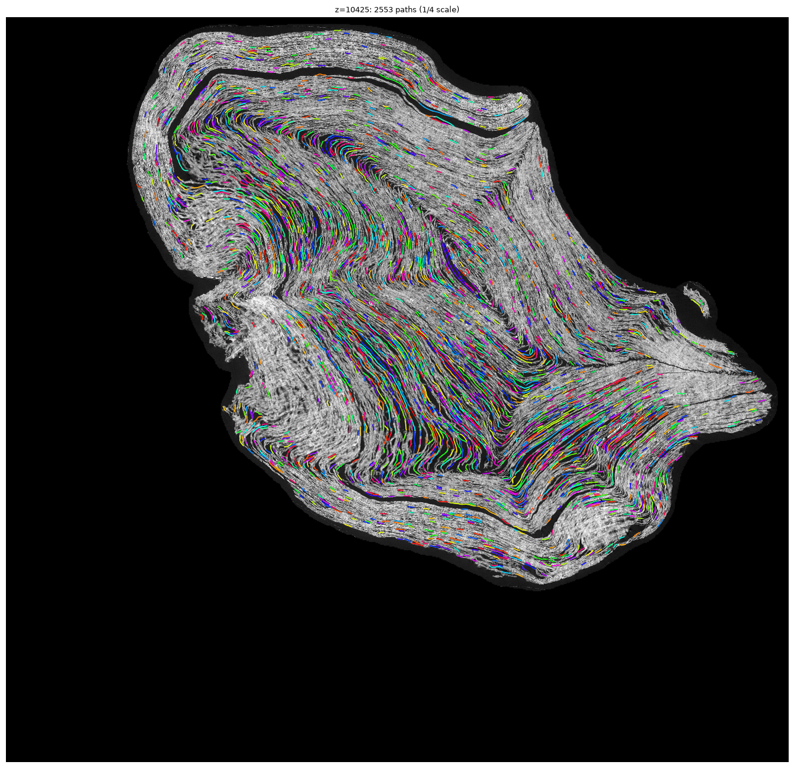
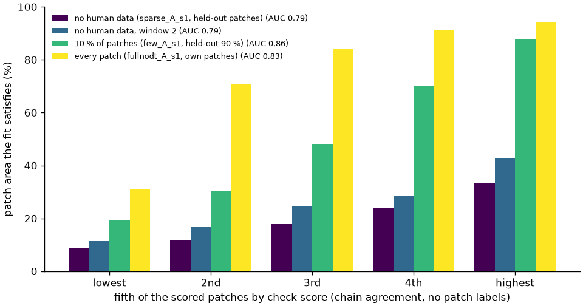

# windcon — automatic same-winding constraints for the Vesuvius Challenge spiral fit

Automatic **"drawn paths"**: long, precision-first same-winding point strips traced in single XY
slices of the CT volume and written as a `same_windings.json` point-collection document that
`villa/spiral-fitting/fit_spiral.py` already consumes.

## Findings in brief

Measured on PHerc. Paris 4 with the published `fit_spiral.py`, scored on human annotations the fits
never saw (details and numbers in the sections below):

1. **The tracer is precise.** 97.6 % of traced length lies on the human arc it claims (held-out
   slices); paths cover 39 % of the arcs' length. Paths link across slices into chains with 1.0 %
   wrong links where verified patches can check them.
2. **As fit input, the chains help only without human annotations.** Chains traced every 5th slice
   raise held-out verified-patch area from 19.4 % to 28.6 % and from 25.6 % to 34.5 % in a second
   window. With a tenth or all of the human patches they add nothing or trade one held-out measure
   against another; relative windings derived from the same paths do help there (point 5).
3. **As a check of a finished fit, they find its errors without human input.** Where a fit
   disagrees with the chains on a verified patch, the fit has likely failed that patch (AUC
   0.79–0.86 for fits with no, some or all human data, in both windows).
4. **More annotation does not fix those errors.** Patches added where the fit fails make it worse:
   the fit cannot satisfy them together with their neighbours, and even fits trained on every
   patch fail them. The failing patches are consistent sheets that the fit places half a winding
   from their neighbours, where the scan shows sheets packed more tightly than around them (13.2
   against 15.9 px per winding). A finer deformation lattice, a softer regulariser, no winding
   inference or no human point collections do not change that. Starting `fit_spiral.py`'s patch
   snap at step 10,000 instead of 25,000 lets a sparsely annotated fit satisfy both sets, but costs
   held-out arcs and fibres between the patches; with every patch the gap stays (65.5–67.8 % of
   the failing patches satisfied against 88.2–88.3 % of random ones).
5. **Automatic relative windings resolve that conflict.** Pairs of traced points on adjacent sheets,
   one winding apart, give the fit the scan's local winding spacing. With a tenth of the patches
   (two to three seeds) they keep the failing patches from hurting the fit (held-out area 60.3 /
   60.6 % with them against 53.8 % without) and raise held-out area by 1.7 points on their own, at
   a cost of 2–3 points of held-out arcs and 1 of fibres. With every patch (one seed) the fit
   satisfies 83 % of the failing patches instead of 60–62 % and the held-out fibres rise from
   27–30 % to 34 %.



*Slice z 10425 at quarter scale, every traced path in its own colour. Per-arc comparisons on the
held-out slices: [`results/panels_test.png`](results/panels_test.png) (human arc yellow, traced
path green, vertices after a departure red).*

## Why this problem

[Open Problems 2026](https://scrollprize.org/2026_open_problems) lists six ways to help. The
[winding-constraints deep dive](https://scrollprize.org/open_problems/winding_annotations) narrows
the team's priority: *"the fastest way to unroll scrolls at scale is to develop methods for creating
winding constraints that are precise and fast enough to use widely"*, with a generator that is
accurate (or measures its confidence), fast, easy to verify, and pluggable into the spiral fit.

- Automatic **relative**-winding constraints already exist (`winding_inference/`: an ML phase model,
  1.1 M rays, 22.7 M crossings in the published `spiral-input` dataset). **Drawn paths** are listed
  under *"Things we have not tried"* and *"likely ... doable with classical computer vision"*.
- Constraints here: Apple M2, 8 GB RAM, no NVIDIA GPU, ~3.3 MiB/s to the open-data bucket. That
  favoured classical CV on streamed crops. The spiral fits below ran later on a separate Ubuntu
  machine with an RTX 4070 SUPER (12 GB).
- Ground truth exists to measure precision: 50 human same-winding arcs drawn inside single slices.

## Data

| What | Where |
| --- | --- |
| CT | PHerc. Paris 4, scan `20260411134726` (2.4 µm, BM18), OME-Zarr level **2** (9.6 µm), `s3://vesuvius-challenge-open-data/PHercParis4/volumes/20260411134726-2.400um-0.2m-78keV-masked.zarr/2` |
| Ground truth | `same_windings.json` from the [`spiral-input` dataset](https://dl.ash2txt.org/datasets/spiral_datasets/PHercParis4/) |

Level 2 is the coordinate frame of the `spiral-input` annotations: points are `p = [x, y, z]` in
9.6 µm voxels (checked by overlaying `relative_windings.json` collections on CT slices; the dataset
README's `(z, y, x)` note does not apply to the point-collection files). Chunks are 128³ raw `uint8`
(2 MiB, uncompressed); `windcon.zarr_io` fetches only the chunks a crop touches and caches them
under `data/cache/`.

## Method (`src/windcon/tracer.py`)

In an XY slice a winding is a bright, textured band between dark gaps. From a seed on a band the
tracer steps 2 px along the band tangent (Hessian eigenvector, σ = 3) and re-centres on the band
using a *thick* normal profile (averaged ±3 px along the tangent to wash out fibre lumens). The band
is delimited by its first valley on each side and centred between its half-level edges. A step is
accepted only if the band is bright, has a real gap on **both** sides, is no wider than one sheet,
moves < 2 px sideways, turns < 15°, and has **no neighbouring band within 8 px** — the signature of
a fork, a merge or a delaminating sheet, the dominant failure mode seen on real data.

- Fork/merge signatures stop the trace immediately; other failures (faint gap, dark spot, crossing
  fibre) may be bridged by coasting ≤ 4 steps, kept only if the band is re-acquired where predicted
  and holds for 3 more steps; every stop trims the last 3 steps.
- Region mode seeds on a 6 px grid, best gap contrast first, skipping seeds on territory already
  claimed by an earlier path; a trace that runs onto another path for 3 steps stops (`joined`).
- Input slice = mean of z−2..z+2 (sheets run roughly along the scroll axis).

## Evaluation (`src/windcon/evaluate.py`)

Production-like **auto mode**: trace every band in a crop around each human arc without looking at
the arc; a path *claims* the arc if 5 consecutive vertices lie within 3 px of it. Walking out from
there, a claiming path is **correct** while within τ = 6 px (median sheet pitch is 21 px) and has
**departed** once it stays farther than τ for 3 vertices while still inside the arc's extent; all
later in-extent length is **wrong**. Path beyond either end of the arc is unscored.

- **precision** = correct / (correct + wrong) path length; **coverage** = union of arc length spanned
  by correct vertices / total arc length; **departures/claim** = share of claiming paths that left.
- Development slices: z ∈ {10604, 12418} (22 arcs, 11.8 k px). Held out: z ∈ {7888, 10343, 13000,
  13500, 14068} (28 arcs, 22.8 k px). Disclosure: after the first test run I inspected test-set
  departures and tried one change (16 px end trim); it did not help on test and was reverted, so
  the numbers below are the configuration chosen on dev, but the test set has been looked at.

### Results

| Fork guard `--min-neighbor-dist` | dev precision | dev coverage | test precision | test coverage | test departures/claim |
| --- | --- | --- | --- | --- | --- |
| 10 px | 1.000 | 0.104 | 0.983 | 0.262 | 0.059 |
| **8 px (default)** | **1.000** | **0.162** | **0.976** | **0.388** | **0.101** |
| 6 px | 0.993 | 0.247 | 0.946 | 0.524 | 0.147 |
| off | 0.970 | 0.300 | 0.943 | 0.561 | 0.152 |

Test precision by slice at the default: z=10343 0.997 (74 claims), 7888 0.970, 14068 0.918,
13500 0.884, 13000 0.882 (5–17 claims each). Coverage collapses in compressed regions (z=10604:
0.094) because the tracer refuses to continue where neighbouring sheets touch. Correct path vertices
sit a median 1.35 px (p90 3.4 px) from the human lines.

Remaining errors are short departures (6–60 px) at low-angle forks and sharp folds where the branch
the tracer keeps is a clean band; see `results/panels_test.png` (green = claiming path, red = after a
departure, yellow = human arc).

Speed: a 492×698 px crop traces in ~1.8 s on one M2 core (65 paths, 5.3 k px), so a full 6000² px
slice is ~3 min/core. On this connection the bottleneck is bandwidth: one 128-slice chunk row of a
full slice at level 2 is ~4 GiB.

## Does it help the spiral fit? (A/B test, `experiments/spiral_fit/`)

Question: does adding the traced paths make `fit_spiral.py` agree better with human annotations it
never saw? Window z 9900–10900 of PHerc. Paris 4, 30,000 steps per fit, villa commit `5a4388f`,
the published `spiral-input` data this window needs (9,424 patch folders, the window's rows of the
level-4 normals sidecar, winding inference, outer shell).

- **Automatic paths:** 47,227 paths (3.0 M px, 197 k points) traced in 18 whole slices every 50
  slices, none within 25 slices of the held-out arcs (`results/spiral_fit/auto_z10425.png` shows one
  slice). Fed as `drawn_control_points.json`, which the fitter samples as its own group of
  same-winding strips.
- **Families:** *sparse* = no human annotations (umbilicus, outer shell, normals, winding
  inference only); *full* = every human input in the window except the held-out arcs.
- **Variants:** A = without paths; B = with paths, fitter defaults; C = B without the strip snap
  (`loss_weight_unattached_pcl_dt = 0`); D = C with 10× unattached strips per step
  (`sample_count_unattached_pcls_per_step = 840`). The full *no-snap* pair applies the D settings
  to both arms.
- **Scoring:** each finished checkpoint is resumed for zero steps with only the scoring inputs
  enabled, so the fitter writes its own satisfaction metrics (`satisfaction_metrics.py`): a point
  passes if it lies within 0.45 of a winding pitch of its collection's winding in spiral space and
  within 6 voxels of that winding's surface in scan space. Never a fit input: 35 human same-winding
  arcs in slices z 10343 and 10604, and 271 human-traced 3D fibres from the dataset's
  `eval_fibers/`. Held out in the sparse family only: the window's 9,174 verified patches and 34
  relative-winding collections.

Sparse family (all held out; %, seed 1 / seed 2):

| metric | A: no paths | B: paths | C: paths, no snap | D: C + 10× strips |
| --- | --- | --- | --- | --- |
| verified patch area | 19.4 / 19.4 | 17.7 / 18.5 | 23.7 / 23.6 | 24.8 / 24.4 |
| arcs, points | 26.7 / 30.3 | 22.1 / 23.3 | 27.6 / 27.8 | 28.6 / 28.3 |
| eval fibres, points | 15.8 / 15.6 | 10.5 / 10.8 | 13.6 / 13.4 | 14.9 / 15.4 |
| relative windings, points | 41.0 / 38.6 | 40.4 / 38.0 | 46.4 / 50.0 | 45.8 / 46.4 |

Full family (%, seed 1 / seed 2; the no-snap pair has one seed):

| metric | A: no paths | B: paths | no-snap A | no-snap D: paths |
| --- | --- | --- | --- | --- |
| held-out arcs, points | 74.2 / 74.6 | 70.1 / 72.8 | 77.7 | 72.9 |
| held-out arcs, whole arcs | 34.3 / 37.1 | 34.3 / 37.1 | 34.3 | 31.4 |
| held-out eval fibres, points | 27.9 / 29.2 | 30.8 / 30.9 | 30.3 | 30.3 |
| relative windings (training input) | 98.2 / 97.0 | 97.6 / 95.8 | 91.0 | 85.5 |
| verified patch area (training input) | 78.4 / 77.7 | 75.9 / 76.6 | 77.3 | 78.1 |

- With the fitter's defaults the paths hurt slightly in both families.
- Without human annotations and without the snap they help: held-out patch area +4–5 points and
  relative windings +5 to +11 points, in both seeds; held-out arcs and fibres do not improve.
- With human annotations they do not help: held-out arcs −2 to −5 points with or without the
  snap; fibres +2–3 points with the defaults and unchanged in the no-snap pair.

Diagnostics:

1. **The snap.** From step 25,000 the fitter snaps every same-winding strip onto its nearest
   winding. In B that loss jumps from 0 to 48.5 at step 25,200 and the final total loss is 80
   against 7 for A. Switching it off (C/D) removes the harm in the sparse family.
2. **Offset** (`offset_check.py`). Traced points sit a median 1.1 voxels outward of nearby verified
   patch surfaces (middle 50 %: −2.7 to +0.5); the held-out human arcs sit at +0.3 (−0.3 to +0.8).
   The tracer centres on the middle of the bright band; the patches and the human arcs agree with
   each other, the traced points sit about 1.4 voxels farther out and are about 3× noisier across
   the sheet.
3. **Short paths** (`analyze_auto.py`). Median ≈ 55 px, 3–4 points each. The human-informed fit
   already agrees with 85 % of path points (ignoring the 6-voxel scan test) before seeing them,
   86 % after. The no-human fit disagrees most with the long paths (77 % of points agree for 40–60
   px paths, 35 % for ≥ 400 px), which is where the new information is.
4. **Sampling share and patch links.** The fitter draws equally from each source file but averages
   its point-collection losses over the sampled points (`sample_shares.py`). In `full_B` the
   automatic paths supply 11.6 % of the strip loss's sampled points and 5.9 % of the
   relative-winding loss's patch pairs, so the human terms keep 88 % and 94 % of their weight: too
   little dilution to explain the drop. But 14,373 paths have two or more points within 2.5 voxels of
   verified patches, which turns them into same-winding links between patches, and the loss on the
   human relative windings rises from 2.5 to 4.5 (mean over steps 15,000–25,000) when the paths are
   added: some of those links contradict the human ones.

### Round 2: paths on the sheet surface, linked through z, with their own budget

The fixes the diagnostics point to, tested the same way (`run_round2.sh` and `run_round3.sh` train
and score, `run_round4.sh` runs the coverage and agreement checks below):

- **Denser slices.** Every 5th slice instead of every 50th: 179 slices (z 9905–10895, still none
  within 25 slices of the held-out arcs), 469,912 paths, 1.86 M points.
- **On the sheet surface** (`chains.py`: `smooth_path`, `shift_inward`). Each path is smoothed
  (Gaussian, σ = 3 vertices ≈ 6 px along the path) and moved 1.9 px along its in-plane normal
  toward the umbilicus (paths running toward the umbilicus stay put). The shift comes from 15 human
  arcs in five slices outside the window (`calibrate_offset.py`: the human points lie a median
  1.88 px inward of the traced paths), so the scoring data stays unused. Against the window's
  verified patches (`offset_check.py`, z 10025, 10425, 10825) the median offset moves from −1.1 to
  +0.2 voxels (human arcs: +0.3). The spread does not shrink: middle 50 % from −1.4 to +1.7
  voxels, against −0.3 to +0.8 for the human arcs.
- **Linked through z** (`chains.py`: `link_slices`, `build_chains`; `build_chains.py`). Paths in
  neighbouring traced slices (5 apart) are linked when each is the other's best partner, with at
  least 8 vertices within 2.5 px of the other path and no third path within 5 px. 181,838 links
  join about 40 % of each slice's paths (median 1.2 px apart) into 288,074 chains: 47 % of the paths
  stay single, 14,555 chains span 5 or more slices (25 % of the paths), the longest 275 voxels of z.
  Each chain is one same-winding collection. Checked against the verified patches (`check_links.py`,
  30,000 random links): in the 8,324 links where the patch under one path also covers its partner,
  the partner lies on another sheet in 1.0 % (7.4 % unclear); 3.0 % of the paths lying mostly on
  one patch leave its sheet somewhere (2.4 % of linked paths, 3.9 % of single ones).
- **Own budget** (`sample_shares.py --emit`, full family). The paths' file gets the same sampling
  weight as each human file and the draw counts grow by one file's share (strips 840 → 1,260,
  relative-winding draws 48 → 64); the strip and relative-winding loss weights grow by the paths'
  expected share of the sampled points and pairs (2.0 → 2.35 and 5.0 → 5.41), so the human terms
  keep exactly the weight they have without paths.
- **No patch links** (`drop_near_patches.py`). A variant drops the path points within 4 voxels
  across or 16 along of a verified patch (788,680 of 1.86 M points), so no path joins two patches.

All round-2 variants use the D settings (no snap, 10× strips). New variants: E = chains (full
family: with own budget); F = the same paths unlinked; H = F without the shift; G = E without the
points on patches; I = E with the fitter's default budget.

Sparse family (all held out; %, one value per seed, mean in bold):

| metric | A: no paths | D: round 1 | E: chains | F: unlinked | H: F unshifted |
| --- | --- | --- | --- | --- | --- |
| verified patch area | 19.4 / 19.4 (**19.4**) | 24.8 / 24.4 (**24.6**) | 29.0 / 28.3 (**28.6**) | 28.0 | 28.0 |
| arcs, points | 26.7 / 30.3 (**28.5**) | 28.6 / 28.3 (**28.4**) | 35.8 / 36.3 (**36.0**) | 31.6 | 35.0 |
| eval fibres, points | 15.8 / 15.6 (**15.7**) | 14.9 / 15.4 (**15.1**) | 16.7 / 16.9 (**16.8**) | 17.3 | 17.2 |
| relative windings, points | 41.0 / 38.6 (**39.8**) | 45.8 / 46.4 (**46.1**) | 45.8 / 50.6 (**48.2**) | 42.2 | 36.8 |

- Without human data the chains now help on every held-out measure, in both seeds: patch area
  +9.2 points over no paths (round 1: +5.2), arcs +7.5 (round 1: none), fibres +1.1, relative
  windings +8.4. The arc gain holds on arcs over patches and away from them alike (+7.2 and +8.2,
  `coverage.json`).
- Density does most of it: the unlinked paths of the 179 slices reach nearly the same patch area
  (28.0) with or without the shift. Linking adds 0.6 points of patch area; its effect on the arcs
  (+4.4 against F, +1.0 against H, one seed each) is within the 3.6-point spread between seeds.
- The shift has no measurable effect (F against H).

Full family (no-snap settings; %, one value per seed, mean in bold). 27 of the 35 held-out arcs and
75 of the 272 eval fibres lie mostly over verified patches (`coverage_split.py`):

| metric | A: no paths | D: round 1 | E: chains, own budget | G: E without patch points | I: E, default budget |
| --- | --- | --- | --- | --- | --- |
| held-out arcs, points | 77.7 / 73.2 / 73.8 (**74.9**) | 72.9 / 73.7 (**73.3**) | 72.7 / 72.7 / 74.8 (**73.4**) | 73.0 / 76.3 (**74.7**) | 76.5 |
| … 27 arcs over patches | 92.9 / 91.2 / 92.3 (**92.2**) | 84.9 / 86.2 (**85.6**) | 87.0 / 85.4 / 87.1 (**86.5**) | 90.7 / 90.0 (**90.4**) | 89.8 |
| … 8 arcs off patches | 47.1 / 36.8 / 36.5 (**40.1**) | 48.8 / 48.5 (**48.7**) | 44.1 / 47.3 / 50.0 (**47.1**) | 37.2 / 48.8 (**43.0**) | 49.8 |
| held-out eval fibres, points | 30.3 / 29.5 / 27.4 (**29.1**) | 30.3 / 31.9 (**31.1**) | 31.6 / 29.7 / 28.4 (**29.9**) | 28.1 / 30.4 (**29.3**) | 31.7 |
| … 75 fibres over patches | 42.7 / 41.0 / 35.1 (**39.6**) | 41.7 / 45.9 (**43.8**) | 43.5 / 38.5 / 36.3 (**39.4**) | 35.6 / 41.3 (**38.5**) | 42.0 |
| … 197 fibres off patches | 25.9 / 25.4 / 24.6 (**25.3**) | 26.2 / 26.9 (**26.5**) | 27.3 / 26.6 / 25.5 (**26.5**) | 25.4 / 26.6 (**26.0**) | 28.0 |
| relative windings (training input) | 91.0 / 92.2 / 91.6 (**91.6**) | 85.5 / 86.8 (**86.1**) | 90.4 / 89.2 / 94.0 (**91.2**) | 92.2 / 91.0 (**91.6**) | 91.0 |
| verified patch area (training input) | 77.3 / 78.4 / 77.8 (**77.8**) | 78.1 / 78.7 (**78.4**) | 78.4 / 78.2 / 78.9 (**78.5**) | 78.4 / 77.8 (**78.1**) | 74.7 |

- Over all held-out arcs no variant beats the fit without paths (74.9 %).
- Over patches the chains cost 5.7 points on the arcs, in all three seeds (92.2 → 86.5); leaving
  out the path points on patches (G) cuts that to 1.8. These arcs carry two thirds of the arc
  points, so the total drops.
- Off patches the chains gain: +7.0 points on the 8 arcs (seed spread about ±5) and +1.2 on the 197
  fibres (+0.9 to +1.4 in each seed pair).
- The own budget does not help measurably: with the fitter's default budget (I, one seed) the chains
  score at least as well on held-out data, though that fit satisfies less of its training patch
  area (74.7 % against 77.3–78.9 % for every other full fit). The human relative windings stay
  satisfied with either budget (E 91.2 %, I 91.0 %, no paths 91.6 %), so their drop with the
  round-1 paths (D, 86.1 %) came from those paths, not from their sampling share.

Do the links hold where no patch can check them? The same points, scored once per single-slice path
and once per chain, against fits that never saw any path (`agree_eval.sh`, `agree_summary.py`;
winding test only, % of points on their collection's winding):

| paths per chain | points | 5 fits with human data: single → chain | 2 fits without: single → chain |
| --- | --- | --- | --- |
| 1 | 785 k | 84.0 → 84.0 | 75.8 → 75.8 |
| 2 | 197 k | 85.0 → 84.7 | 75.6 → 75.0 |
| 3–4 | 226 k | 85.9 → 85.3 | 74.4 → 72.8 |
| 5–9 | 272 k | 86.8 → 85.7 | 71.4 → 68.0 |
| 10–19 | 170 k | 88.3 → 86.7 | 67.2 → 61.6 |
| ≥ 20 | 55 k | 88.2 → 85.9 | 62.6 → 53.9 |

The fits with human data put linked paths on one winding almost as often as unlinked ones: −0.3
points for two-path chains, where a wrong link would put about half the chain off its winding,
consistent with the 1 % wrong links found against the patches. The fits without human data
disagree most with the long chains, which is where the chains carry information those fits lack.

### Round 3: automatic relative windings between traced paths

The fits without human data fail mostly on winding assignment, not on position: with the 6-voxel
scan test dropped, 51–53 % of the held-out arc points are still off their arc's winding in the
chain-trained fits, against 13–15 % with human data (`diag_scanfree` in `results_ab.json`). First,
cheap levers (sparse family; %, mean of two seeds for A and E, one seed otherwise):

| metric | A: no paths | E: chains | J: E, 3× strip weight | K: E, 10× | L: A without WI | M: E without WI |
| --- | --- | --- | --- | --- | --- | --- |
| verified patch area | 19.4 | 28.6 | 28.4 | 23.6 | 20.9 | 30.0 |
| arcs, points | 28.5 | 36.0 | 34.5 | 25.3 | 18.3 | 24.2 |
| arcs, winding test only | 37.1 | 48.3 | 51.3 | 41.3 | 26.2 | 36.3 |
| eval fibres, points | 15.7 | 16.8 | 15.3 | 11.8 | 13.7 | 13.5 |
| relative windings, points | 39.8 | 48.2 | 47.0 | 40.4 | 41.0 | 45.8 |

A stronger strip loss does not help (3×) or hurts (10×). The neural winding-inference rays (WI,
the published automatic relative windings) are not what misassigns the windings: without them the
arcs lose 10–12 points. So the next constraint type is the one the open-problems page singles out,
relative windings, here made from the traced paths (`relwind.py`, `find_adjacency.py`,
`build_relwind.py`):

- From every 4th vertex (8 px) of every traced path a ray runs along the path normal, both ways,
  to the first other traced path within 60 px that runs within 30° of parallel.
- The CT profile along the ray, averaged ±3 px along the path like the tracer's, decides. *Clean*:
  after the first path's band and a real dark gap (the tracer's gap-contrast test), the next band
  peak is the path that was hit, within 3 px. *Blocked*: a band peak comes first, so an untraced
  sheet lies between.
- Two paths are neighbouring windings with at least 3 clean rays and no blocked ray; the outer one
  is one winding further (winding numbers grow away from the umbilicus in all 254 human
  relative-winding collections). Each pair gives up to 3 rays as two-point collections: wind_a 0
  on the inner point, 1 on the outer. Two points each, because the fitter thins collections to
  points 16 voxels apart (keeping both ends) and neighbouring sheets are often closer.

Over the 179 slices 3.75 M rays reach another traced path: 58 % clean, 41 % blocked. 171,681
neighbouring pairs result (515,043 collections). As a graph with chains as nodes, no pair joins a
chain to itself and 0.95 % contradict a maximum spanning forest of the rest; the largest connected
parts join 8,398 chains across 94 windings. Checks:

- The human relative windings sit mostly where nothing was traced: only 20 % of their points in
  the window lie within 4 px of a traced path (median 13.9 px), so only 6 of 132 human neighbour
  steps can be checked directly (3 confirmed, none contradicted, 3 not connected).
- The gap inside an accepted pair matches the spacing humans annotate between neighbouring
  windings here: median 14.9 px (human 17.5), 10th percentile 10.6 (human 10.2).
- Fits that never saw the pairs, with or without human data, put the two points one winding apart
  for 56–60 % of the collections and on one winding for 18 %. The latter grows as the sheets get
  closer (8–12 px apart: 29–37 %; 20–30 px: 8–9 %): the fits merge closely packed sheets, so their
  agreement is no precision estimate. Crops of such pairs show two separate bands with a dark gap
  (`results/spiral_fit/relwind_pairs.png`: top row, pairs the fit puts on one winding; bottom row,
  pairs it puts one winding apart).

In the fit (sparse family; %, mean of two seeds for A and E, one seed for N and O):

| metric | A: no paths | E: chains | N: E + pairs | O: pairs alone |
| --- | --- | --- | --- | --- |
| verified patch area | 19.4 | 28.6 | 27.4 | 21.4 |
| arcs, points | 28.5 | 36.0 | 36.1 | 24.4 |
| eval fibres, points | 15.7 | 16.8 | 16.5 | 13.8 |
| relative windings, points | 39.8 | 48.2 | 44.6 | 41.6 |

The pairs add nothing on top of the chains, and alone they cost 4 points on the arcs. They carry
the same kind of information as the neural winding inference (neighbouring sheets one winding
apart) with far fewer samples, so P (N without WI) and Q (O without WI) test whether they are
redundant or wrong. Fits without WI (one seed each):

| metric | L: nothing | Q: pairs | M: chains | P: chains + pairs |
| --- | --- | --- | --- | --- |
| verified patch area | 20.9 | 20.2 | 30.0 | 29.9 |
| arcs, points | 18.3 | 13.9 | 24.2 | 24.2 |
| eval fibres, points | 13.7 | 11.8 | 13.5 | 14.2 |
| relative windings, points | 41.0 | 50.6 | 45.8 | 47.6 |

Without WI the pairs raise the held-out human relative windings by 9.6 points (scan test dropped:
56.6 → 71.1), above what WI alone gives (39.8 for A): the pairs are right where human annotators
drew neighbouring windings. With WI present they add nothing (N, O), so they are redundant with it.
Neither kind of cross-layer constraint makes up for the along-sheet chains: the pairs alone lower
the arcs (13.9 against 18.3), while WI raises them by 10 points and the chains by 6–8. Raw numbers
of this round: `results/spiral_fit/relwind_stats.json`, `agree_relwind.json` (fit agreement, with
the same-winding control), `check_relwind.py` output in `check_relwind.json`.

### Round 4: closing the gap around the held-out arcs

Rounds 2 and 3 kept round 1's rule of tracing no slice within 25 slices of the held-out arcs. At
every 5th slice that leaves a 55-slice gap with no paths around each arc slice (nearest traced
slices 10315/10370 and 10575/10630), while every other location lies within 2.5 slices of a path.
The human patches are not excluded there, so the arc comparison was tilted against the paths, in
the full family most of all; the held-out patch area covers the whole window and is barely
affected. `run_gapfill.sh` traces the 20 missing slices of the same every-5th grid (199 slices).
The arc slices 10343 and 10604 are not on the grid, so they stay untraced, 1–4 slices from paths
like any other location; the tracer never sees the arcs. The path variants are re-run on this set
(suffix g); the no-path baselines are unchanged.

Filling the gap changes nothing measurable in the sparse family: held-out patch area 28.7 / 28.7
(E: 29.0 / 28.3), fibres 16.6 / 17.0 (E: 16.7 / 16.9). The arcs swing with the seed (28.3 / 35.4;
E 35.8 / 36.3) because they fail in clusters (limitation 2). The paths next to the arcs are right
where they overlap them: 99 %+ precision in all four neighbouring slices (coverage 48 % at z 10343,
8–13 % at 10604). In the full family (no-snap settings; %, mean over seeds):

| metric | A: no paths (3 seeds) | E: gapped chains (3) | Eg: gap-filled chains (2) | Gg: Eg without points on patches (2) |
| --- | --- | --- | --- | --- |
| held-out arcs, points | 74.9 | 73.4 | 71.9 | 77.0 |
| … 27 arcs over patches | 92.2 | 86.5 | 84.1 | 91.0 |
| … 8 arcs off patches | 40.1 | 47.1 | 47.4 | 48.7 |
| held-out eval fibres, points | 29.1 | 29.9 | 32.1 | 28.1 |
| … 75 fibres over patches | 39.6 | 39.4 | 44.4 | 34.3 |
| … 197 fibres off patches | 25.3 | 26.5 | 27.7 | 26.0 |

With the gap filled, both seeds beat all three no-path seeds on the fibres, over patches and off
them (+3.0 overall). The arcs over patches drop in every seed: where chains run next to human
patches they conflict with them. Dropping the chain points on patches (Gg) removes that conflict
(arcs over patches 91.0) and gives the best arcs of any variant (77.0, within A's seed spread of
73.2–77.7), but it loses the fibre gain (fibres over patches 34.3). On patch-covered ground the two
held-out sets disagree about the chains, so with full human data the paths' value depends on the
measure.

The same round adds the case the open-problems page cares about most, human data where it is
sparse: the *few* family trains on a random 10 % of the window's verified patches (942 of 9,424,
fixed seed, `split_patches` in `setup_ab.py`) plus every human point collection, with the no-snap
settings; the other 8,482 patches are held out (`datasets/eval_few`). few_A has no paths, few_Ig
adds the gap-filled chains with the fitter's default budget.

Result (seed 1 / seed 2): held-out patch area 54.6 / 55.3 without paths, 54.8 / 54.5 with them;
arcs 46.9 / 46.7 against 46.5 / 46.1; fibres 16.2 / 15.9 against 16.6 / 16.6. A tenth of the human
patches lifts held-out patch area from 19 % to 55 %, and the 2 M automatic points add nothing on
top. What decides each held-out patch is its distance to the nearest training patch (seed 1):
74 % satisfied within 10 voxels, 59 % at 10–30, 36 % at 30–60 and 26–27 % beyond 60 (the
no-human-data level), with or without paths. Far from human patches (≥ 60 voxels, 914 patches)
the chains add 1–3 points in the few fit but 5.4 in the sparse fit on the same patches, and
nothing even where they cover a patch well. Their benefit without human data is therefore global,
the overall shape of the spiral, which a tenth of the human patches supplies from far away (in the
sparse family, patches with no chain on them also improved, 28 → 34 %).

A second window, z 13400–14400 (14,775 verified patches; human arcs at z 13500 and 14068), repeats
the sparse-family test in its own experiment root (`run_window2.sh`): the same tracer settings,
every 5th slice on a grid offset by 2 so the arcs lie 1–3 slices from traced slices, chains built
the same way, two seeds each of no paths (A) and chains (Eg).

Result (%, seed 1 / seed 2, mean in bold; held out: 14,775 patches, 8 arcs with 273 points,
fibres with 13,047 points in the window, 144 relative-winding points):

| metric | A: no paths | Eg: chains |
| --- | --- | --- |
| verified patch area | 25.7 / 25.4 (**25.6**) | 34.7 / 34.2 (**34.5**) |
| arcs, points | 31.5 / 31.5 (**31.5**) | 30.0 / 34.4 (**32.2**) |
| arcs, winding test only | 35.2 / 34.1 (**34.7**) | 42.5 / 41.0 (**41.8**) |
| eval fibres, points | 25.2 / 24.7 (**25.0**) | 28.0 / 29.2 (**28.6**) |
| relative windings, points | 35.4 / 37.5 (**36.5**) | 38.2 / 40.3 (**39.3**) |

The sparse-family gain replicates in both seeds: +8.9 points of held-out patch area (window 1:
+9.2) and +3.7 on the fibres (window 1: +1.1).

### Round 5: the paths as a check of a finished fit

As fit inputs the paths help only where there is no human data. They can still say where a fit is
wrong, which is the "easy to verify" part of the brief and might tell annotators where to work next
(`error_detector.py`). For a fit that never trained on the chains, `agree_eval.sh` scores every
chain against it (winding test only); each verified patch gets the mean agreement of the chain
points lying on it (within 3.5 voxels; patches with fewer than 20 such points are unscored) and the
score is compared with the fit's satisfaction of that patch, which the chains never saw:

| fit | patches scored | AUC (patch ≥ 50 % satisfied, area-weighted) | AUC of chain coverage / distance from axis | lowest fifth of scores | highest fifth |
| --- | --- | --- | --- | --- | --- |
| sparse_A_s1 (no human data; patches held out) | 7,464 | 0.79 | 0.58 / 0.52 | 8.9 % | 33.1 % |
| sparse_A_s2 | 7,464 | 0.79 | 0.58 / 0.53 | 9.1 % | 32.5 % |
| fullnodt_A_s1 (its own training patches) | 7,464 | 0.83 | 0.51 / 0.69 | 31.3 % | 94.4 % |
| full_A_s1 (its own training patches) | 7,464 | 0.82 | 0.53 / 0.67 | 31.3 % | 93.8 % |
| few_A_s1 (10 % of patches; the other 90 % held out) | 6,712 | 0.86 | 0.56 / 0.51 | 19.1 % | 87.8 % |
| window 2 sparse_A_s1 (no human data; patches held out) | 13,163 | 0.79 | 0.51 / 0.54 | 11.4 % | 42.7 % |



*Each fit's scored patches split into fifths by check score; bars are the share of each fifth's
patch area the fit satisfies (`plot_fit_check.py`).*

The signal is the agreement itself: where the chains are (coverage) predicts almost nothing, and
depth in the scroll (distance from the axis, either direction) much less. Even the human-informed
fits fail a fifth of their own training patches where the chains disagree with them (31 %
satisfied there against 71–94 % elsewhere). The automatic paths, computed without any human
input, find those places. `error_detector.py --flag-out` writes the chains a fit disagrees with,
worst first, as a point-collection document in the human annotations' format (36,753 of the
288,074 chains scored against few_A_s1); it needs no verified patches, so it works on a scroll
without any. Raw numbers: `results/spiral_fit/error_detector/`.

Does that help annotators? `select_patches.py` adds 471 more patches (5 % of the window's) to the
few family's 942, chosen three ways from the 6,712 held-out patches the check can score: at random,
where the chains disagree most with few_A_s1 (no ground truth), and where few_A_s1 actually fails
(oracle; meant as the upper bound). few_A_s1 satisfies 52.4 % of the random picks' area, 12.8 % of
the targeted picks' and 0.2 % of the oracle picks', so the check does find the failures. Each arm
is refitted with the few settings (no paths as inputs) and scored on the 7,203 held-out patches
none of the arms trains on (`datasets/eval_al`, `targeting_summary.py`; one seed per arm, two for
the targeted one):

| fit | held-out patch area | arcs | fibres | own training patches |
| --- | --- | --- | --- | --- |
| few_A: 942 patches (2 seeds) | 59.3 / 58.2 | 46.9 / 46.7 | 16.2 / 15.9 | 84.9 / 85.8 |
| + 471 random | 65.8 | 53.6 | 19.6 | 84.1 |
| + 471 where the chains disagree (2 seeds) | 56.2 / 56.2 | 50.3 / 50.8 | 17.5 / 17.9 | 82.5 / 83.2 |
| + 471 where the fit fails (oracle) | 53.8 | 48.3 | 18.6 | 78.5 |

Random patches help; patches in the failure regions make the fit worse, the true failures most of
all. Split by distance to the nearest added patch (change in held-out area against few_A_s1):

| added patches | 0–15 voxels | 15–40 | 40–100 | > 100 |
| --- | --- | --- | --- | --- |
| random | +21.2 | +5.7 | +4.7 | −2.0 |
| where the chains disagree | +12.2 | −10.1 | −3.4 | −1.6 |
| where the fit fails | +25.9 | −21.8 | −3.2 | −2.1 |

Every added patch fixes its immediate neighbourhood, but forcing the fit through a failure region
breaks the ring one to three windings around it, and the fit satisfies fewer of its own training
patches. So the failure regions the chains locate are not short of annotation: the fit cannot
satisfy patches there without breaking their surroundings.

Is it the fit's flexibility, or an input that contradicts the patches? Four settings, each fitted
without and with the oracle patches (one seed each): a 10-voxel instead of the default 16-voxel
deformation lattice (328 M instead of 81 M parameters, 7 it/s alone), the fine lattice learning at
the coarse one's rate (default 0.2 of it), no winding inference, and patches as the only human
input (no human point collections):

| fit setting | held-out area, no extra patches | + 471 oracle patches | change |
| --- | --- | --- | --- |
| default (16-voxel lattice) | 59.3 / 58.2 | 53.8 | −5.5 |
| 10-voxel lattice | 53.4 | 45.6 | −7.8 |
| fine lattice at the coarse rate | 37.6 | 35.8 | −1.8 |
| default, without the winding inference | 54.2 | 48.3 | −5.9 |
| default, patches the only human input | 57.6 | 51.8 | −5.8 |

The finer lattice generalises worse on its own and the oracle patches still hurt, by more; the
faster fine lattice breaks the fit (61.9 % of its own training patches satisfied against 84.9 %),
so the default rate is tuned. Removing the winding inference or the human point collections
leaves the harm unchanged, so neither input is what conflicts. Nor are the failing patches wrong:
`patch_check.py` assigns every automatic path to the patch it mostly lies on and counts the paths
that leave that patch's surface. 0.14 % of the paths on the oracle picks leave them, 0.27 % on the
random picks, 3.1 % across all patches: the patches the fit fails are consistent sheets.

What conflicts with them is the other patches. Inside the oracle fits the picks become
satisfiable (78–82 % of their area) but the 942 base patches drop from 83–86 % to 70–77 %: the
fitter trades one set of human patches against the other. Fits trained on *every* verified patch,
the oracle picks included, also fail them: as their own training patches the five full-family
fits satisfy 58.9–62.2 % of the oracle picks' area, 65.6–68.1 % of the targeted picks',
82.0–84.2 % of the random picks' and 78.2–79.5 % of the common held-out set (`picks_in_fits.py`,
`results/spiral_fit/picks_in_fits.json`). So a fixed set of consistent human patches cannot be
satisfied together with the rest under the spiral model. They are not random: the oracle picks
sit nearer the outside of the scroll (median 20.9 windings below the outer shell, 5.2 at the 10th
percentile; random picks 54.5 and 11.1).

What kind of conflict? `patch_windings.py` maps every quad of a patch through a fit's checkpoint
and unwraps its winding coordinate over the patch grid, separating two failure kinds: part of a
patch off the patch's own winding (the fitted sheets cut across the patch; a whole winding off
would be a missing or extra sheet), or the whole patch between two fitted sheets (its median
winding coordinate far from a whole number: a phase offset). The fits keep patches whole: in the
all-patches fit only 0.4 % of the oracle picks' quads are off their patch's median, and 1 % of the
picks span a winding. The failures are phase: 20 % of the oracle picks sit more than 0.35 winding
from the nearest fitted sheet, and those are 4 % satisfied, against 84 % for picks within 0.2 of a
sheet. In the 10 %-patches fit 62 % of the oracle picks sit between sheets. Adding them moves them
onto the sheets, and the share of base patches between sheets rises from 5.6 % to 9.4 %, with
their internal consistency unchanged. So the conflict is not a missing winding inside any patch:
neighbouring consistent patches need the sheets in radial positions about half a winding apart
from what one smooth spiral can give both, and satisfying one set shifts the other off. A local
change in sheet spacing sharper than the deformation follows (a compressed or delaminated
region), or a phase slip around a sheet that ends or splits, would do that
(`results/spiral_fit/patch_windings/`). In the scan, five of the six largest between-sheet oracle
picks border a large dark void where outer layers peel apart and fray
(`results/spiral_fit/phase_picks.png`; red: the pick's trace in that slice). Measured over all
picks (share of a 121 px neighbourhood in voids wider than a 6 px-radius disk), 16 % of the oracle
picks have at least a tenth of their neighbourhood in large void, against 12 % of the targeted
picks and 7 % of the random ones. Large voids are part of it but most oracle picks have none
nearby. Nor is it a surface convention: measured against the band-centre traced paths, every set
of patches sits on the front face of its sheet alike (median path offset −1.15 to −1.43 px, no
patch on the back face).

Over all 9,120 patches in the all-patches fit, 11 % sit between sheets (patches within 0.2 of a
sheet are 91 % satisfied). `phase_conflicts.py` takes each quad of those patches and its nearest
neighbour quad of another patch in the same slice, displaced along the scroll radius within 40 px,
and compares the fit's winding difference with the dark gaps the scan shows between them
(validated on pairs with known answers: 94 % of adjacent-sheet pairs give exactly one gap, 99 % of
same-sheet pairs none; sheets that touch can hide a gap):

- The conflicts are sharp. 71 % of these neighbours sit on a sheet, a median 13.4 px away along
  the radius, and the fit puts the two a median 0.54 winding apart (middle half 0.41–0.68). For
  on-sheet patches the same differences are whole numbers (0.15 / 0.85 / 1.05 at the quartiles).
- They sit where sheets are packed tightly. The scan's sheet spacing next to between-sheet
  patches is a median 13.2 px per winding (quartiles 10.7–17.2), against 15.9 (12.4–21.4) next to
  on-sheet patches.
- The scan does not settle which way the fit is wrong at these pairs: it shows one gap where the
  fit has half a winding in 50 % of them and none in 40 %.

So a smooth spiral fit fails consistent patches where the sheets pack more tightly than around
them, putting neighbouring patches half a winding apart. Raw numbers:
`results/spiral_fit/patch_windings/`.

Can a fit that follows the tighter packing satisfy both sets? The patch snap (the loss that pulls
every patch onto its nearest whole winding) is the largest loss term at the end of these fits and
by default only starts at step 25,000 of 30,000. Starting it at step 10,000 (few_ADT two seeds,
few_oracDT one):

| fit | base patches (942, trained) | oracle picks | held-out area (eval_al) |
| --- | --- | --- | --- |
| few_A (default snap) | 84.9 / 85.8 | 0.2 / 26.7 (held out; seed 1 chose them) | 59.3 / 58.2 |
| few_ADT (early snap) | 90.0 / 89.9 | 17.9 / 20.5 (held out) | 59.4 / 58.9 |
| few_orac (default snap, + oracle picks) | 76.9 | 81.6 (trained) | 53.8 |
| few_oracDT (early snap, + oracle picks) | 84.7 | 84.8 (trained) | 57.9 |

With the early snap the fit satisfies both sets at once (84.7 % and 84.8 %, against 76.9 % and
81.6 %), and adding the oracle patches costs 1.0–1.5 points of held-out area instead of 4.4–5.5.
Without them the early snap satisfies more of its own patches (90.0 / 89.9 % against 84.9 /
85.8 %) at the same held-out area, but not the oracle picks it never saw: 17.9 / 20.5 %, against
26.7 % for the independent default seed. With a tenth of the patches, much of the conflict was the
late snap. The training logs agree: with the default start the oracle fit ends with a patch-snap
loss of 23.0 that 5,000 steps did not bring down (10.0 without the picks); started at step 10,000
it ends at 11.4 (5.9), and the deformation regulariser ends higher (16.5–16.7 against 11.0–13.1),
so the deformation bends further to put neighbouring patches on their windings. A softer
deformation regulariser alone (a quarter of its weight, few_ASD / few_oracSD) does not do this:
base patches 85.3 / 76.4 %, oracle picks 7.6 / 81.1 %, held-out area 58.4 / 53.4 %, the same as
the default. It is the timing of the snap, not the stiffness of the deformation.

The bending costs accuracy between the patches. The few-family early-snap fits lose held-out arcs
(43.9 / 42.3 % against 46.9 / 46.7) and fibres (14.8 / 14.1 against 16.2 / 15.9). With every
patch (fullnodt_ADT, two seeds, against three seeds of fullnodt_A) the early snap satisfies more
of every training set (random picks 88.2–88.3 % against 82.0–83.6, oracle picks 65.5–67.8 against
59.8–62.2, the eval_al patches 83.8–84.4 against 78.2–79.5), but held-out arcs away from patches
fall to 24.0–24.5 % (36.5–47.1) and fibres away from patches to 22.7–23.2 % (24.6–25.9), while
arcs over patches hold at 89.2–91.3 (91.2–92.9). The oracle picks stay 20–23 points behind the
random ones, so with dense patches the snap timing explains little of the conflict. The early
snap fits the patches at the expense of the surface between them; the default start generalises
better. Chains do not rescue it: added to the early-snap fit (fullnodt_IgDT) they cost arcs
(67.0 % against 67.7–69.0) and relative windings (83.1 against 89.2–91.0).

What the fit lacks at these sites is the scan's local winding spacing. The automatic relative
windings of round 3 carry it (pairs of points on adjacent sheets, one winding apart), reach the
conflict sites as often as anywhere (an automatic pair within 20 px of 22 % of the between-sheet
patches' quads, 21 % of the on-sheet ones') and had only been tested without human patches. Fed
to the few family through the otherwise unused drawn-points slot, a sampling stratum of their own
(few_ARW three seeds, few_oracRW two, `setup_ab.py`), about 12,600 of the 515,043 pairs touch the
patches (the fitter's cross-patch collections, scored by the patch relative-winding loss where they
join two patches) and the rest act as two-point strips with their winding difference:

| fit | held-out area (eval_al) | base patches (trained) | oracle picks | held-out arcs | fibres |
| --- | --- | --- | --- | --- | --- |
| few_A | 59.3 / 58.2 | 84.9 / 85.8 | 0.2 / 26.7 (held out) | 46.9 / 46.7 | 16.2 / 15.9 |
| few_ARW (+ automatic relative windings) | 60.4 / 60.5 / 60.3 | 91.4 / 91.5 / 90.6 | 40.5 / 49.6 / 38.9 (held out) | 44.8 / 44.7 / 43.0 | 14.9 / 14.6 / 15.2 |
| few_orac (+ oracle picks) | 53.8 | 76.9 | 81.6 (trained) | 48.3 | 18.6 |
| few_oracRW (+ both) | 60.3 / 60.6 | 88.6 / 89.4 | 85.5 / 87.3 (trained) | 40.9 / 44.8 | 16.4 / 16.2 |
| few_ARWh (pairs at half share) | 60.0 | 89.8 | 36.5 (held out) | 47.4 | 15.1 |
| few_oracRWh (half share, + oracle picks) | 61.7 | 89.2 | 89.1 (trained) | 43.4 | 17.2 |

With them the oracle patches stop hurting: the fit satisfies both sets (88.6–89.4 % and
85.5–87.3 %) and the held-out area stays at 60.3 / 60.6 % instead of falling to 53.8 %. Without
the oracle patches they raise held-out area to 60.3–60.5 % in three seeds, above both default
seeds (59.3 / 58.2; 1.7 points on the means), and satisfy 38.9–49.6 % of the hard picks unseen
(26.7 % for the independent default seed). The cost is again between the patches: held-out arcs
fall about 2–3 points (43.0–44.8 % against 46.7–46.9) and fibres about 1 (14.6–15.2 against
15.9–16.2). At half the sampling share (few_ARWh / few_oracRWh, `pcl_sampling_weights`; one seed
each) the arcs cost disappears without the oracle patches (47.4 %) while held-out area stays at
60.0 %, and with them held-out area reaches 61.7 % (471 random extra human patches reach 65.8 %).

With every patch (fullnodt_ARW_s1, one seed, against three seeds of fullnodt_A) 87,550 collections
touch the patches, and the conflict largely goes away (the early snap moved it only to 66–68 %):

| | fullnodt_A (3 seeds) | fullnodt_ARW_s1 |
| --- | --- | --- |
| oracle picks satisfied (trained) | 59.8–62.2 | 83.3 |
| random picks satisfied (trained) | 82.0–83.6 | 88.5 |
| all training patches | 77.3–78.4 | 86.9 |
| held-out fibres: all / over patches / away from patches | 27.4–30.3 / 35.1–42.7 / 24.6–25.9 | 33.6 / 49.2 / 28.0 |
| held-out arcs: all / over patches / away from patches | 73.2–77.7 / 91.2–92.9 / 36.5–47.1 | 72.7 / 86.5 / 45.1 |

The fit satisfies 83 % of the oracle picks instead of 60–62 % and 87 % of all its patches, and the
held-out fibres rise 3–6 points, over patches and away from them. The arcs over patches lose
5 points, and all arcs end 0.5 points below the lowest default seed (72.7 % against 73.2–77.7).

Cost on the RTX 4070 SUPER: 31–50 min per fit with two fits sharing the card (59 min for a 10-voxel
lattice fit), whole-card peak 9.8 GiB; tracing 200 slices takes 40–60 min on 16–20 CPU workers.
Raw numbers: `results/spiral_fit/` (`results_ab.json` per run, `coverage.json`, `agree.json`,
`chains_stats.json`, `check_links.json`, `targeting.json`, `select_patches.json`, `patch_check.json`,
`error_detector/`, `window2/`).

Reproduce on a CUDA machine (the scripts expect `~/Documents/postel/vesuvius_challenge`), from a
copy of this repository there:

```bash
P=~/Documents/postel/vesuvius_challenge; S=experiments/spiral_fit
rsync -a ./ $P/windcon/ && cd $P/windcon && uv sync
mkdir -p $P/tools && cp $S/env.sh $P/ && cp $S/run_fit.sh $P/tools/ && source $P/env.sh
git clone --filter=blob:none --sparse https://github.com/ScrollPrize/villa $P/villa
(cd $P/villa && git checkout 5a4388f && git sparse-checkout set spiral-fitting vesuvius/src/vc3d_fiber_format)
(cd $P/villa/spiral-fitting && uv sync)
python3 $S/fetch_dataset.py --out $P/data/PHercParis4 --z-begin 9900 --z-end 10900
uv run python $S/trace_window.py --out $P/auto_paths --bbox 800 7660 1260 7800 --workers 12 \
  --z 9925 9975 10025 10075 10125 10175 10225 10275 10375 10425 10475 10525 10575 10675 10725 10775 10825 10875
uv run python $S/prepare_pcls.py --human $P/data/PHercParis4/same_windings.json \
  --auto-dir $P/auto_paths --heldout-z 10343 10604 --out $P/pcls
python3 $S/setup_ab.py --postel $P
# Trains two fits at a time, then scores them; repeat with _s2 for the second seed.
bash $S/run_queue.sh sparse_A_s1 sparse_B_s1 sparse_C_s1 sparse_D_s1 \
  full_A_s1 full_B_s1 fullnodt_A_s1 fullnodt_D_s1
# Round 2: every 5th slice; build_chains, drop_near_patches, own budget, checks, eight fits.
uv run python $S/trace_window.py --out $P/auto_paths_z5 --bbox 800 7660 1260 7800 --workers 20 \
  --z $(python3 -c "print(*[z for z in range(9905, 10900, 5) if min(abs(z - 10343), abs(z - 10604)) > 25])")
bash $S/run_round2.sh
bash $S/run_round3.sh sparse_H_s1 fullnodt_I_s1 fullnodt_A_s3 fullnodt_E_s3
bash $S/run_round4.sh fullnodt_A_s1 fullnodt_A_s2 fullnodt_A_s3 full_A_s1 full_A_s2 \
  sparse_A_s1 sparse_A_s2 sparse_E_s1 fullnodt_E_s1
# Round 3: adjacency rays, relative-winding pairs, their fit agreement, and the sweep/relwind fits.
uv run python $S/find_adjacency.py --raw-dir $P/auto_paths_z5 --out $P/adjacency \
  --umbilicus $P/data/PHercParis4/umbilicus.json --bbox 800 7660 1260 7800 --workers 6
uv run python $S/build_relwind.py --chains-dir $P/pcls --adj-dir $P/adjacency --out $P/pcls
python3 $S/setup_ab.py --postel $P
AGREE_KEYS=relwind bash $S/agree_eval.sh fullnodt_A_s1 full_A_s1 sparse_A_s1
bash $S/run_queue.sh sparse_J_s1 sparse_K_s1 sparse_L_s1 sparse_M_s1 \
  sparse_N_s1 sparse_O_s1 sparse_P_s1 sparse_Q_s1
# Round 4: the 20 gap slices (trace_window.py with the excluded z, then find_adjacency.py), the
# gap-filled set, its fits, the few family and window 2.
bash $S/run_gapfill.sh fullnodt_Eg_s1 sparse_Eg_s1 few_A_s1 few_Ig_s1 fullnodt_Eg_s2 sparse_Eg_s2
bash $S/run_window2.sh sparse_A_s1 sparse_Eg_s1 sparse_A_s2 sparse_Eg_s2
# Round 5: the fit check, then the annotation-targeting arms.
AGREE_KEYS=chains bash $S/agree_eval.sh sparse_A_s1 fullnodt_A_s1 few_A_s1
uv run python $S/error_detector.py --run $P/runs/few_A_s1 --chains-dir $P/pcls \
  --dataset $P/data/PHercParis4 --per-patch $P/runs/few_A_s1/per_patch.json \
  --flag-out $P/runs/few_A_s1/flagged_chains.json
E=results/spiral_fit/error_detector  # the reports above, copied into this repository
uv run python $S/plot_fit_check.py "$E/sparse_A_s1.json:no human data" "$E/w2_sparse_A_s1.json:window 2" \
  "$E/few_A_s1.json:10 % of patches" "$E/fullnodt_A_s1.json:every patch" --out fit_check_quintiles.png
uv run python $S/select_patches.py --dataset $P/data/PHercParis4 \
  --per-patch $P/runs/few_A_s1/per_patch.json \
  --satisfied $P/runs/few_A_s1/eval_patches/satisfied_fitted.json --count 471
python3 $S/setup_ab.py --postel $P
bash $S/run_queue.sh few_rand_s1 few_targ_s1 few_orac_s1 few_A_s2
# The fit-setting tests (finer lattice, fine-lattice rate, no winding inference, patches only,
# patch snap from step 10,000, softer regulariser).
bash $S/run_queue.sh few_AR10_s1 few_ALR_s1 few_oracR10_s1 few_oracLR_s1 \
  few_ANW_s1 few_oracNW_s1 few_AP_s1 few_oracP_s1
bash $S/run_queue.sh few_ADT_s1 few_oracDT_s1 few_ASD_s1 few_oracSD_s1 \
  fullnodt_ADT_s1 fullnodt_IgDT_s1 few_ADT_s2 fullnodt_ADT_s2
bash $S/run_queue.sh few_ARW_s1 few_oracRW_s1 fullnodt_ARW_s1 few_ARW_s2 few_oracRW_s2 few_ARW_s3 \
  few_ARWh_s1 few_oracRWh_s1 fullnodt_ARW_s2 few_oracRW_s3
uv run python $S/targeting_summary.py $P/runs/few_*_s? --dataset $P/data/PHercParis4
uv run python $S/picks_in_fits.py $P/runs/fullnodt_A_s? $P/runs/full_A_s? $P/runs/few_A_s1 \
  $P/runs/fullnodt_ADT_s? $P/runs/fullnodt_IgDT_s1 $P/runs/few_ADT_s? $P/runs/fullnodt_ARW_s? \
  $P/runs/few_ARW_s? --dataset $P/data/PHercParis4
uv run python $S/coverage_split.py $P/runs/sparse_*_s? $P/runs/full*_*_s? $P/runs/few_*_s? \
  --dataset $P/data/PHercParis4 --heldout $P/pcls/heldout_same.json --fibers $P/fiber_points.json
uv run python $S/patch_check.py --chains-dir $P/pcls --dataset $P/data/PHercParis4 \
  --minus verified_patches_few10 --sets verified_patches_few10_{rand,targ,orac}471
# Phase vs whole-winding failures (spiral-fitting environment, needs CUDA).
(cd $P/villa/spiral-fitting && .venv/bin/python $P/windcon/$S/patch_windings.py \
  --checkpoint $P/runs/fullnodt_A_s1/checkpoint_fitted.ckpt --dataset $P/data/PHercParis4 \
  --umbilicus $P/data/PHercParis4/umbilicus.json --outer-shell $P/data/PHercParis4/outer_shell \
  --set orac=verified_patches_few10_orac471 --minus verified_patches_few10 \
  --satisfied $P/runs/fullnodt_A_s1/satisfied_fitted.json)
# Every patch of the all-patches fit, then neighbours and scan gaps around between-sheet patches.
(cd $P/villa/spiral-fitting && .venv/bin/python $P/windcon/$S/patch_windings.py \
  --checkpoint $P/runs/fullnodt_A_s1/checkpoint_fitted.ckpt --dataset $P/data/PHercParis4 \
  --umbilicus $P/data/PHercParis4/umbilicus.json --outer-shell $P/data/PHercParis4/outer_shell \
  --set all=verified_patches --out $P/pw_all.json --dump-quads $P/quads.npz)
uv run python $S/phase_conflicts.py --quads $P/quads.npz --phase $P/pw_all.json \
  --umbilicus $P/data/PHercParis4/umbilicus.json --ct-pairs 800
uv run python $S/summarize_ab.py $P/results_ab.json
```

## Usage

```bash
uv sync
mkdir -p data/paris4 && curl -sSfL -o data/paris4/same_windings.json \
  https://dl.ash2txt.org/datasets/spiral_datasets/PHercParis4/same_windings.json

# Trace one crop (volume-level pixels) -> same-winding point collections + evidence sidecar + overlay
uv run windcon trace --z 12418 --box 3138 3630 2803 3501 \
  --out out/same_windings_auto_z12418.json --png out/z12418_paths.png

# Reproduce the evaluation (downloads ~1.7 GiB of CT chunks on first run)
uv run windcon eval --panels --out results
uv run windcon eval --min-neighbor-dist 6 --out results/nd6

uv run pytest
```

`trace` writes points every 20 px (`--spacing`), roughly the density of the human annotations, and
`<out>.stats.json` with per-path length, stop reasons, minimum neighbour distance, minimum gap
contrast and bridged fraction, for downstream filtering. The document loads through the upstream
`load_point_collection` + `normalise_pcl_winding_annotations` exactly like the human
`same_windings.json` (every collection classified as same-winding). To use it in a fit, save it as
the dataset's `drawn_control_points.json` and set `loss_weight_unattached_pcl_dt` to 0.

A whole window as fit input (round 2 onward; `--volume` takes any scroll's OME-Zarr level with
voxels near 9.6 µm, the scale the tracer's thresholds were set at):

```bash
S=experiments/spiral_fit
# Trace every 5th slice of the window (CPU; crops stream from the open-data bucket).
uv run python $S/trace_window.py --out auto_paths --bbox X0 X1 Y0 Y1 --z $(seq 9905 5 10895) \
  --workers 16 [--volume <zarr level URL>]
# Smooth, shift onto the sheet face and link through z into chains.
uv run python $S/build_chains.py --raw-dir auto_paths --umbilicus <dataset>/umbilicus.json \
  --out pcls --delta 1.9
# Rays between neighbouring paths -> relative-winding pairs (adjacent sheets, one winding apart).
uv run python $S/find_adjacency.py --raw-dir auto_paths --out adjacency \
  --umbilicus <dataset>/umbilicus.json --bbox X0 X1 Y0 Y1 --workers 16 [--volume <zarr level URL>]
uv run python $S/build_relwind.py --chains-dir pcls --adj-dir adjacency --out pcls
```

The fitter reads one extra point-collection file, `<dataset>/drawn_control_points.json`. Without
human annotations, put the chains there (`cp pcls/auto_chains.json`); with verified patches, the
relative-winding pairs (`cp pcls/auto_relwind.json`), which help there and the chains do not
(round 5). Then run `fit_spiral.py` with `loss_weight_unattached_pcl_dt` 0 and
`sample_count_unattached_pcls_per_step` 840 (10× the default; the fitter scales it to the window).

## Limitations and next steps

1. **Two windows, one scroll, few seeds.** The sparse-family gain and the fit check replicate in a
   second window (z 13400–14400), but both windows are PHerc. Paris 4, the scroll with the human
   annotations used for scoring; most variants have 1–3 seeds, and the annotation-targeting arms
   have one seed each. The tracer runs unchanged on other scans. In 1,400 × 1,400 crops placed
   halfway between the axis and the edge (`results/other_scrolls/`) it traces 231 paths (13,352 px)
   in Paris 4, 343 (21,960 px) in PHerc. 139's 2.4 µm scan, where they follow the sheets by eye,
   and 90 (4,665 px) in PHerc. 125's 9.36 µm scan (1.2 m propagation, one of the Grand Prize
   volumes), where it mostly abstains. Neither scroll has human annotations to measure precision.
2. **Evaluation noise.** 35 held-out arcs in two slices: seeds of the same variant differ by up to
   4.5 points, enough to hide the full-family effects. The arcs also fail in clusters: one regional
   winding miscount fails several neighbouring arcs at once (in sparse_Eg_s1, arcs 40, 42, 44, 45,
   48 and 51 at z 10604 drop together from 41–100 % to 11–55 %), so the arcs are a handful of
   independent samples. Held-out patch area and the eval fibres are the robust measures; more
   held-out arcs, spread over more slices, would make the arcs one too.
3. **Human data.** With a tenth of the human patches the chains add nothing as fit inputs. With all
   of them the chains raise the held-out fibres by about 3 points but cost arcs over patch-covered
   ground; dropping the chain points on patches (Gg) reverses both. What the human-informed fits
   still get wrong are consistent human patches that conflict with the other patches under the
   spiral model: neighbouring patches end up half a winding apart where the sheets pack more
   tightly than around them (round 5). The chains find these regions without human input, but
   neither chains, more human patches, a finer or softer deformation, nor dropping the winding
   inference or the human point collections fix them; an earlier patch snap fixes them only with
   sparse patches, and at the cost of the surface between patches. The automatic relative
   windings, which carry the scan's local winding spacing, remove the harm of the conflicting
   patches with a tenth of the patches (two to three seeds, round 5), again at some cost in arcs
   and fibres, and with every patch (one seed) they lift the failing patches from 60–62 % to 83 %
   satisfied and the held-out fibres by 3–6 points. Next: more seeds, a lower weight for the pairs
   (few_ARWh in `setup_ab.py`), and a second window. The chain check can score any such change
   without human data.
4. **Cross-sheet noise.** The shift fixed the median offset but not the spread, which stays about
   3× the human arcs'; neither shifting nor smoothing moved the fits measurably. Refining each
   point to the sheet face from the intensity profile is the next step if the offset matters.
5. **Wrong links and forks.** 1.0 % of the checkable links join different sheets and 3 % of the
   paths leave their sheet, and one wrong link imposes a wrong constraint on a whole chain: at 1 %
   per link a 20-path chain is wholly right only 83 % of the time, close to how much less often the
   chain-trained fit satisfies ≥ 20-path chains than their single paths (71.2 % against 84.5 %).
   Candidates: split chains where the fitted spiral disagrees, require cross-slice agreement at
   forks, or use the m7 surface prediction
   (`representations/predictions/surfaces/...surface-m7-L2-th0.2.zarr`, same frame) as a second
   vote.
6. **Connectivity through z.** Chains link only about 40 % of the paths between traced slices.
   Tracing vertical (XZ) planes, where sheets run along z, does not fix this in this crushed scroll:
   in a plane through the axis the 606 traced paths have a median z-extent of 43 slices and only 26
   reach 100 (28.6 s per 1,000 × 6,860 plane), because sheets are wavy and folded in z.
7. **Compressed regions** are mostly skipped by design; level 1 (4.8 µm) crops may separate sheets
   there at 8× the data.
8. **Scale-out** belongs next to the data (same-region AWS): the 179 slices of this window took
   40 min on 20 cores, about 4.5 core-minutes per whole slice.

## Licence

Code: MIT (`LICENSE`). The PHerc. Paris 4 scans and annotations are Vesuvius Challenge open data
under their own terms; this repository does not redistribute them.
